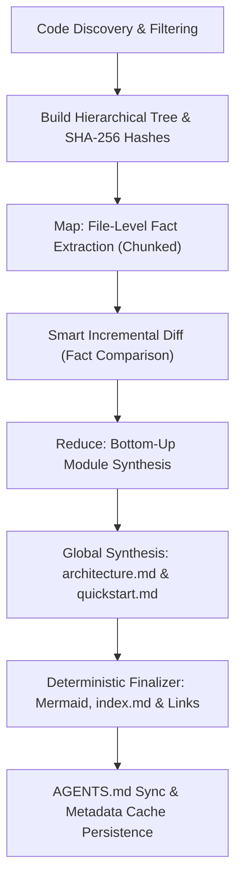

# Code-Reducer

[](https://sonarcloud.io/summary/overall?id=arrase_code-reducer)
[](https://sonarcloud.io/summary/overall?id=arrase_code-reducer)
[](https://sonarcloud.io/summary/overall?id=arrase_code-reducer)
[](https://sonarcloud.io/summary/overall?id=arrase_code-reducer)
[](https://sonarcloud.io/summary/overall?id=arrase_code-reducer)
[](https://sonarcloud.io/summary/overall?id=arrase_code-reducer)
[](https://sonarcloud.io/summary/overall?id=arrase_code-reducer)
[](https://sonarcloud.io/summary/overall?id=arrase_code-reducer)
[](https://sonarcloud.io/summary/overall?id=arrase_code-reducer)
[](https://sonarcloud.io/summary/overall?id=arrase_code-reducer)
[](https://sonarcloud.io/summary/overall?id=arrase_code-reducer)

**Code-Reducer** is a lightweight, high-performance command-line tool written in Go that automatically generates, validates, and queries developer-friendly, comprehensive wikis for extensive repositories.

Designed specifically for **local development and private LLMs**, Code-Reducer uses a custom **Hierarchical Map-Reduce Strategy** to analyze large codebases using small, local LLM models (e.g., 7B, 9B, or 26B parameters) via **Ollama** without exceeding context windows or degrading output quality.

---

## 🚀 Key Strengths

* **Hierarchical Map-Reduce Pipeline**: Breaks codebase synthesis into a structured Map-Reduce pipeline to document large directories recursively, staying strictly within local LLM context limits (`numCtx * 2 - runeCount(promptOverhead)` characters).
* **Optimized for Private & Local LLMs**: Built specifically to leverage Ollama (e.g., `ornith:9b` or `gemma4:26b`), eliminating expensive cloud API costs and keeping proprietary code local.
* **Smart Incremental Updates**: Uses a filesystem SHA-256 hash cache and fact-level comparison to skip module re-synthesis when code edits do not alter extracted technical facts, and skips global documentation regeneration when top-level module summaries and directory structure remain unchanged.
* **Deterministic Wiki Finalizer (`finalizeWiki`)**: Automatically sanitizes and heuristically validates Mermaid diagrams (degrading unrecoverable blocks to `text` fences), generates `<docs_dir>/index.md`, stamps module provenance headers, and validates/auto-repairs internal Markdown links and GitHub heading anchors.
* **Built-In Section-Level BM25 Search & Read**: Provides `code-reducer search` and `code-reducer read` commands for fast, zero-LLM-cost retrieval of documentation sections by keyword and source path hints.
* **Multi-Language Documentation & Customizable Prompts**: Supports generating documentation prose in any target language (`--language` / `CODE_REDUCER_LANGUAGE`) while preserving code identifiers, and allows overriding all system, synthesis, quickstart, consolidation, and extraction prompts via `.code-reducer.yaml`.
* **Enterprise-Grade Security Sandbox**: Features path traversal guards, atomic process locking, and TOCTOU symlink hijacking defenses for safe workspace operations.

---

## 🏃 Quick Start

### Prerequisites
* **Go**: Version 1.26 or higher.
* **Ollama**: Running locally with a compatible model downloaded (e.g., `ornith:9b` or `gemma4:26b`).

### 1. Build from Source (or Download Release)
*Note: Precompiled binaries are available attached to each release.*

Compile the executable binary inside the repository root:
```bash
go build -o code-reducer main.go
```

### 2. Run the Tool (Implicit Setup)
If you run `code-reducer init` or `code-reducer update` in a terminal (TTY) and the `.code-reducer.yaml` configuration file does not exist, the interactive configuration wizard will launch automatically.

Alternatively, you can manually run the setup wizard first:
```bash
./code-reducer setup
```

### 3. Generate the Wiki
Initialize the documentation cache and build the initial markdown files:
```bash
./code-reducer init
```

### 4. Keep Docs Updated
Incrementally update the wiki whenever code files change:
```bash
./code-reducer update
```

### 5. Search and Read the Wiki
Query ranked sections across the generated wiki and read specific pages or heading anchors:
```bash
./code-reducer search "context limit chunking" -p internal/engine -n 5
./code-reducer read modules/internal/engine/README.md
```

---

## 🛠️ CLI Command Reference

### Global Persistent Flags
Available across commands (`init`, `update`, `search`, `read`):
* `--model-id <string>`: Override the LLM model ID (e.g., `--model-id gemma4:26b`).
* `--num-ctx <int>`: Override the Ollama context window size in tokens (e.g., `--num-ctx 20000`).
* `--language <string>`: Target language for generated documentation prose (e.g., `English`, `Spanish`, `es`, `en`).

### 1. `code-reducer setup`
Runs an interactive setup flow in the current directory to generate the `.code-reducer.yaml` configuration file. If a `.code-reducer.yaml` file already exists, all prompts default to its current values:
* LLM Model ID (defaults to `ornith:9b`)
* Ollama Base URL (defaults to `http://localhost:11434`)
* Ollama Context Size (defaults to `8192`)
* Custom directories, files, or glob patterns to ignore (comma-separated; enter `clear` or `none` to reset)
* Documentation output folder name (defaults to `wiki`)
* Output Language (leave empty for default English)

### 2. `code-reducer init`
Scans the repository, builds the hierarchical directory tree, and generates the initial set of wiki markdown pages:
* Generates module pages under `<docs_dir>/modules/<module>/README.md` with provenance headers (`> **Module:** ... | **Source Files:** ...`).
* Synthesizes global `<docs_dir>/architecture.md` and `<docs_dir>/quickstart.md` (including a developer Task Routing table).
* Runs the deterministic finalizer to sanitize/validate Mermaid blocks, generate `<docs_dir>/index.md`, and validate/auto-repair internal links and heading anchors.
* Persists the metadata cache in `<docs_dir>/.metadata.json`.
* Creates or idempotently updates the `<!-- CODE-REDUCER:START --> ... <!-- CODE-REDUCER:END -->` block in `AGENTS.md` in the repository root.
* *Note: Implicitly launches the interactive setup wizard if `.code-reducer.yaml` is missing in a TTY session. Fails if the project has already been initialized.*

### 3. `code-reducer update`
Detects files added, modified, or deleted since the last run and performs a smart incremental documentation refresh:
* **Configuration & Prompt Hash Invalidation**: Compares `cache.StepsHash` against `computeStepsHash(cfg)` (which hashes `model_id`, `language`, all prompt templates, and all `extraction_steps`). Any change invalidates the cache and triggers a full rebuild.
* **Fact-Level Short-Circuit**: Re-extracts facts for modified files and compares them with cached `Facts`. If the extracted facts are identical, only the file's SHA-256 hash is updated in `.metadata.json` and directory re-synthesis is skipped.
* **Bottom-Up Propagation**: Rebuilds only directories affected by effective file changes (or missing module docs) and propagates affected status upward to parent directories.
* **Global Docs Short-Circuit**: Skips regenerating `architecture.md` and `quickstart.md` if no files were added or deleted, all global docs exist on disk, and the root (`.`) and top-level child module summaries are unchanged.
* **Finalization & Pruning**: Prunes deleted files and orphaned module docs, then runs `finalizeWiki` to refresh `<docs_dir>/index.md`, validate Mermaid blocks, and check internal links.

### 4. `code-reducer search <query> [--path/-p <file>] [--limit/-n <N>]`
Searches generated wiki markdown pages (`<docs_dir>/`, excluding `index.md` and hidden files) at ATX heading section granularity using weighted **BM25** ranking:
* `--path`, `-p <path>` (repeatable / comma-separated): Boosts sections whose page path, module path, or provenance source files match the given path hint (`2.0x` score multiplier).
* `--limit`, `-n <int>`: Maximum number of ranked results to return (defaults to `5`).
* Outputs ranked `<page>#<anchor>` targets ready to pass directly to `code-reducer read`, along with the section heading, provenance source files, and a matching snippet.

### 5. `code-reducer read <page[#section]>`
Reads a full markdown documentation page or extracts a specific heading section from `<docs_dir>`:
* Accepts targets with or without a leading `<docs_dir>/` prefix (e.g., `architecture.md`, `wiki/quickstart.md#task-routing`, or `modules/internal/engine/README.md#synthesis-pipeline`).
* Enforces `security.SafeResolve` containment within `<docs_dir>`, rejecting path traversal (`..`), hidden files/directories, and non-`.md` files.
* When `#<anchor>` is specified, extracts the matching ATX heading section up to the next heading of equal or higher level; if the anchor is not found, returns an error listing all available anchors on that page.

---

## ⚙️ Configuration (`.code-reducer.yaml` & Environment Variables)

Code-Reducer stores configuration parameters in `.code-reducer.yaml` in the root of the repository (saved with `0600` permissions).

### Example Configuration
```yaml
# The model ID loaded into your local Ollama instance
model_id: ornith:9b

# URL of the local or remote Ollama server
ollama_base_url: http://localhost:11434

# Custom context window size in tokens
ollama_num_ctx: 20000

# Target directory to write generated markdown documentation
docs_dir: wiki

# Optional target language for documentation prose (e.g. English, Spanish, es, en)
language: ""

# System instructions injected into every LLM request
system_prompt: |
    You are Code-Reducer, a technical code analyzer and documentation writer. Follow instructions strictly with maximum technical conciseness.
    Rules:
    1. Extract and report ONLY verifiable facts explicitly present in the provided source code.
    2. Do NOT invent behaviors, speculate on unshown code, or guess downstream consequences.
    3. Do NOT copy source code blocks or write conversational filler.

# Synthesis prompt for directory modules
module_synthesis_prompt: |-
    Task: Write a technical documentation page for a code module based on the provided list of its internal components.
    Rule 1: Group related functions and types under appropriate Markdown headings.
    Rule 2: Explain the responsibility of the module and its internal data flow.
    Rule 3: When the module has non-trivial internal data or control flow, include a fenced ```mermaid diagram (flowchart TD or sequenceDiagram, max 10 nodes) following strict Mermaid label safety: quote any node label containing parentheses, brackets, colons, or semicolons (e.g., A["parse(input)"]); never use lowercase 'end' as a flowchart node ID (use 'endNode' instead); do not use raw angle brackets <T> inside labels.
    Rule 4: Keep it highly technical, concise, and free of source code blocks.

# Synthesis prompt for the global architecture overview (architecture.md)
architecture_prompt: |-
    Task: Write the global architecture document (architecture.md) based on the module summaries.
    Rule 1: Focus exclusively on the global architecture vision, system boundaries, end-to-end data flow, and module interactions.
    Rule 2: Include a grounded fenced ```mermaid architecture/data-flow diagram (flowchart TD or sequenceDiagram, max 10 nodes) following strict Mermaid label safety: quote any node label containing parentheses, brackets, colons, or semicolons (e.g., A["parse(input)"]); never use lowercase 'end' as a flowchart node ID (use 'endNode' instead); do not use raw angle brackets <T> inside labels.
    Rule 3: Keep it concise, technical, and developer-friendly.

# Synthesis prompt for the developer quickstart guide (quickstart.md)
quickstart_prompt: |-
    Task: Write the developer quickstart guide (quickstart.md) based on the module summaries.
    Rule 1: Focus exclusively on prerequisites, build/installation steps, available CLI commands and flags, configuration (.code-reducer.yaml and environment variables), and package structure.
    Rule 2: Include a Task Routing markdown table (| Goal / Task | Module Doc | Key Source Files |) that maps developer tasks ("I want to...") to the relative module documentation paths (modules/.../README.md) and source files provided in the project context.
    Rule 3: Keep it concise, actionable, and strictly factual.

# Prompt used to consolidate chunks of the same file
file_fact_consolidation_prompt: |-
    Task: Consolidate and deduplicate facts extracted from different chunks of the same file into a single, concise summary.
    Rule 1: Merge duplicate items and preserve only unique, verifiable facts.
    Rule 2: Keep bullet points to 1 line each; do NOT copy source code blocks or add long explanations.
    Rule 3: If all inputs are 'None', output solely 'None'.

# Customize the LLM extraction pipeline steps
extraction_steps:
    - name: API_SIGNATURES
      prompt: |-
        Task: Extract the public API surface.
        Output: Markdown bullet list of exported/public types, functions, and methods, strictly 1 line per signature with parameters and return types. Do NOT explain internal logic or copy code blocks. If none exist, output solely 'None'.
    - name: BUSINESS_LOGIC
      prompt: |-
        Task: Extract the core purpose and domain rules.
        Output: Maximum 5 concise bullet points describing the primary domain problem and high-level logic. Ignore syntax and boilerplate. Do NOT copy code blocks. If none exist, output solely 'None'.
    - name: STATE_AND_CONCURRENCY
      prompt: |-
        Task: Identify mutable state and thread safety.
        Output: Concise bullet list (1 line per item) of modified package/global state, struct fields, or synchronization mechanisms (locks, mutexes, channels, atomics). Do NOT copy code blocks. If stateless, output solely 'None'.
    - name: ERRORS_AND_SIDE_EFFECTS
      prompt: |-
        Task: Analyze external I/O and error propagation.
        Output: Concise bullet list (1 line per item) of external system interactions (filesystem, network, subprocesses, environment) and error handling patterns. Do NOT copy code blocks. If none exist, output solely 'None'.

# Directory paths, files, or glob patterns to ignore during scanning
ignore:
  - README.md
  - .code-reducer.yaml
  - go.sum
  - go.mod
  - screenshots
  - examples
```

### Configuration Fields & 4-Tier Precedence Order
Code-Reducer resolves configuration values through a strict 4-tier hierarchy:

```text
[1. CLI Flags] ──► [2. Environment Variables] ──► [3. .code-reducer.yaml] ──► [4. Built-in Defaults]
```

| Field (`.code-reducer.yaml`) | CLI Flag | Environment Variable | Built-in Default | Description |
| :--- | :--- | :--- | :--- | :--- |
| `model_id` | `--model-id` | `CODE_REDUCER_MODEL_ID` | `ornith:9b` | Ollama model identifier used for extraction and synthesis. |
| `ollama_base_url` | — | `OLLAMA_BASE_URL` | `http://localhost:11434` | Base URL of the local or remote Ollama HTTP server. |
| `ollama_num_ctx` | `--num-ctx` | `OLLAMA_NUM_CTX` | `8192` | Context window size (`num_ctx`) passed to Ollama requests (must be a positive integer). |
| `docs_dir` | — | — | `wiki` | Output directory (relative to repository root) for generated wiki pages and `.metadata.json`. |
| `language` | `--language` | `CODE_REDUCER_LANGUAGE` | `""` (English) | Target prose language. Appends a `LanguageInstruction` to system prompts so prose, headings, and tables are written in the chosen language while keeping code identifiers, paths, CLI flags, env vars, and Mermaid keywords intact. |
| `system_prompt` | — | — | `DefaultSystemPrompt` | Base system instructions prepended to every LLM call. |
| `module_synthesis_prompt` | — | — | `DefaultModuleSynthesisPrompt` | System instructions for synthesizing directory-level module documentation (`modules/<dir>/README.md`). |
| `architecture_prompt` | — | — | `DefaultArchitecturePrompt` | System instructions for synthesizing `<docs_dir>/architecture.md`. |
| `quickstart_prompt` | — | — | `DefaultQuickstartPrompt` | System instructions for synthesizing `<docs_dir>/quickstart.md` with a Task Routing table. |
| `file_fact_consolidation_prompt` | — | — | `DefaultFileFactConsolidationPrompt` | System instructions for deduplicating facts across chunks of a multi-chunk source file. |
| `extraction_steps` | — | — | `DefaultExtractionSteps` (4 steps) | Ordered list of `{name, prompt}` extraction passes executed on each source file chunk. |
| `ignore` | — | — | `[]` | Deduplicated list of files, directories, or gitignore glob patterns excluded from scanning (merged with `.gitignore` and `docs_dir`). |

### Multi-language & Infrastructure Support
Code-Reducer can be configured to document software codebases as well as Infrastructure-as-Code (IaC) or cloud topology. See an example configuration tailored for Terraform project analysis in [examples/terraform/.code-reducer.yaml](examples/terraform/.code-reducer.yaml).

---

## 🏗️ Architecture & Technical Deep Dive

### 1. Hierarchical Map-Reduce Engine



#### Tree Structure Construction & Provenance Headers
Code-Reducer groups discovered source files into a logical directory hierarchy (`DirNode` tree). When synthesizing each directory node into `<docs_dir>/modules/<module>/README.md`, `formatModuleDocument` prepends a deterministic provenance blockquote header listing the module path and sorted source filenames:
```markdown
> **Module:** `internal/engine` | **Source Files:** `cache.go`, `chunking.go`, `finalize.go`, `llm.go`, `orchestrator.go`, `synthesize.go`, `tree.go`
```

#### Comprehensive Cache Hash (`computeStepsHash`)
The metadata cache (`<docs_dir>/.metadata.json`) stores a `steps_hash` SHA-256 digest computed by `computeStepsHash(cfg)` over:
* `ModelID` and `Language`
* `SystemPrompt`, `ModuleSynthesisPrompt`, `ArchitecturePrompt`, `QuickstartPrompt`, and `FileFactConsolidationPrompt`
* Every `ExtractionStep`'s `Name` and `Prompt`

If any of these settings or prompts change between runs, `RunUpdate` automatically invalidates all cached file facts and module summaries and performs a full regeneration.

#### Context Budgeting (`calculateFileLimit`) & The Map Phase
To stay strictly within local LLM context windows without truncating source files or intermediate summaries, both file extraction and batch reduction budget characters using `calculateFileLimit(numCtx, promptOverhead)`:
* **Character Budget Formula**: `limit = numCtx * 2 - runeCount(promptOverhead)` (`maxCharsMultiplier = 2`), with a floor of `defaultChunkOverlap * 2` (`1600` runes).
* **Dynamic Overlapping Chunks**: For file extraction, `maxExtractionOverhead` measures the rune count of the system prompt plus the largest extraction step wrapper (including target file path and sibling directory file list). Files exceeding `fileLimit` runes are split via `chunkTextWithOverlap` on newline boundaries (searching the last 25% of the window) with an overlap of `800` runes (clamped to `fileLimit / 4`).
* **Multi-Step Fact Extraction**: Each chunk is evaluated sequentially across all configured `extraction_steps`. Outer markdown fences are stripped (`stripOuterMarkdownFence`), `"None"`/`"N/A"` responses are filtered out (`isNoneFact`), and multi-chunk facts for a given step are consolidated via `reduceFileFacts`.

#### The Reduce Phase (Hierarchical Consolidation & Loop Prevention)
* **Dynamic Batching (`reduceWithLLM` & `reduceItems`)**: Component briefings (file facts and child subsystem summaries) are grouped into batches up to `maxChars = numCtx * 2 - runeCount(promptOverhead)` runes.
* **Oversized Item Expansion**: Any single item exceeding `maxChars` is split via `expandOversizedItems` into `maxChars / 2` chunks with `maxChars / 10` overlap before batching.
* **Multi-Layer Reduction & Loop Guard**: When multiple batches are required, each batch is summarized with `partialBatchInstruction` and recursively reduced. If an LLM pass fails to condense the intermediate text (output rune count is `>= 95%` of input rune count), `reduceItems` halts recursion and concatenates the intermediate summaries to guarantee termination.

#### Smart Incremental `update` Short-Circuit
During `code-reducer update`, the orchestrator minimizes redundant LLM calls at two levels:
1. **File Fact Short-Circuit (`resolveEffectiveChanges`)**: When a tracked file's SHA-256 hash changes (`StatusModified`), Code-Reducer immediately extracts its new `Facts` and compares them against the previously cached `Facts`. If `newFacts == prevEntry.Facts` (e.g., formatting changes, comments, or internal edits that do not change extracted facts), the file's new SHA-256 is saved in `.metadata.json`, the file is excluded from effective changes, and neither its directory nor its parent modules are re-synthesized.
2. **Global Docs Short-Circuit**: After bottom-up tree synthesis completes, `GenerateStandardDocs` (`architecture.md` and `quickstart.md`) is executed **only** if at least one of the following holds:
   * Any of `architecture.md`, `quickstart.md`, or `index.md` is missing from `<docs_dir>`.
   * Repository file structure changed (`StatusAdded` or `StatusDeleted` files).
   * The root module summary (`cache.Modules["."]`) or any top-level child directory summary (`tree.Children`) changed compared to its pre-update cached value.
   Otherwise, global documentation regeneration is skipped entirely.
3. **Stale Cache & Orphan Pruning (`pruneStaleCache`)**: Deleted files and removed directories are pruned from `.metadata.json`, and any orphaned `<docs_dir>/modules/.../README.md` files and empty module subdirectories are removed from disk.

#### Enriched Project Context & Task Routing in `quickstart.md`
When generating `architecture.md` and `quickstart.md`, `buildProjectContextItems` supplies the LLM with a structured, grounded context payload:
1. **`## Project Directories & Module Documentation Map`**: Lists every directory in the repository and maps each documented module path to its relative wiki path (`modules/<dir>/README.md`) and sorted source files.
2. **`## Root Module Summary`**: The synthesized root (`.`) summary.
3. **`### Top-Level Submodule: <path>`**: The synthesized summaries for all immediate child directories of the repository root.

Guided by `DefaultQuickstartPrompt`, `quickstart.md` uses this map to generate a grounded **Task Routing** markdown table (`| Goal / Task | Module Doc | Key Source Files |`) that maps concrete developer goals (`"I want to..."`) to exact module documentation pages and source files.

#### Deterministic Finalizer (`finalizeWiki`)
At the end of every `init` and `update` run (when work is performed), `finalizeWiki` executes three deterministic post-processing passes across all markdown files in `<docs_dir>`:
1. **Mermaid Diagram Sanitization & Validation (`sanitizeAndValidateMermaid`)**:
   * Inspects all fenced ```` ```mermaid ```` blocks.
   * For `flowchart` and `graph` diagrams, automatically repairs common small-LLM syntax mistakes line-by-line:
     * Renames reserved lowercase `end` node identifiers to `endNode` in node definitions (`end[...]` -> `endNode[...]`) and arrow edges (`--> end` / `end -->`).
     * Preserves compound node shapes (`(((...)))`, `((...))`, `([...])`, `[(...)]`, `[[...]]`, `{{...}}`, `[...]`, `(...)`, `{...}`) and quotes unquoted labels containing special characters (`():;<>`), converting `;` to `,`, `<`/`>` to `&lt;`/`&gt;`, and inner `"` to `'`.
   * Runs `heuristicMermaidError` to verify diagram type headers (`flowchart`, `graph`, `sequenceDiagram`, `stateDiagram`, `stateDiagram-v2`, `classDiagram`, `erDiagram`, `gantt`, `pie`, `gitGraph`, `mindmap`, `timeline`, `journey`, `C4Context`, `xychart-beta`), non-empty body lines, balanced quotes/brackets, and absence of unquoted special characters or `end` node IDs.
   * Any unclosed or invalid Mermaid block is gracefully degraded to a ```` ```text ```` code fence preceded by `<!-- code-reducer: mermaid parse failed (<reason>) -->` so broken diagrams never break Markdown renderers.
2. **Deterministic Navigation Index (`generateWikiIndex`)**:
   * Generates `<docs_dir>/index.md` linking to `architecture.md`, `quickstart.md`, and every documented module in sorted order, complete with a truncated 140-rune summary description (`extractSummaryDescription`) and source file count/list (`formatNodeFiles`).
3. **Internal Link & Heading Anchor Validation with Auto-Repair (`validateMarkdownLinks`)**:
   * Parses all inline Markdown links outside code fences and inline code spans, stripping any previous `<!-- code-reducer: broken internal link ... -->` stamps first.
   * Resolves relative file paths safely within the repository. If a relative link target does not exist at the written path, `tryAutoRepairLink` checks unambiguous candidate paths under `<docs_dir>/modules/` and `<docs_dir>/` (including `<dir>/README.md`) and rewrites the relative link in place.
   * Validates `#anchor` fragments on target `.md` files against GitHub-style heading slugs (`extractHeadingAnchors`, ignoring `L<num>` line anchors).
   * Stamps any remaining broken links, non-portable root-absolute links (`/path`), or missing heading anchors with a `<!-- code-reducer: broken internal link [...] ... -->` HTML comment immediately above the line.

#### Idempotent `AGENTS.md` Synchronization (`updateAgentGuidelines`)
During `code-reducer init`, Code-Reducer creates `AGENTS.md` or updates the delimited block bounded by `<!-- CODE-REDUCER:START -->` and `<!-- CODE-REDUCER:END -->` in place (preserving any surrounding custom instructions). The block directs AI coding agents to `<docs_dir>/architecture.md`, `<docs_dir>/quickstart.md`, `<docs_dir>/index.md`, `<docs_dir>/modules/`, and the `code-reducer search` and `code-reducer read` CLI commands.

---

### 2. Section-Level BM25 Search & Read (`internal/search`)

* **Section Indexing (`parseMarkdownSections`)**: Splits each markdown file in `<docs_dir>` (excluding `index.md` and dot-prefixed files) into sections at `#` and `##` headings (falling back to `###` if a page has no `##` headings). Extracts module path and source file list from each page's `> **Module:** ... | **Source Files:** ...` provenance header.
* **CamelCase-Aware Tokenization (`tokenize`)**: Splits words on non-alphanumeric boundaries and decomposes CamelCase and acronym compounds (e.g., `SafeResolve` -> `saferesolve`, `safe`, `resolve`; `HTMLParser` -> `htmlparser`, `html`, `parser`).
* **Weighted BM25 Scoring (`scoreAndRankSections`)**: Scores sections using BM25 (`k1 = 1.2`, `b = 0.75`) with field weights:
  * **Title / Page + Heading tokens**: weight `3.0`
  * **Provenance Module + Source File tokens**: weight `2.0`
  * **Section Body tokens**: weight `1.0`
  * Applies a multi-term coordination boost (`1 + 0.25 * (matchedTerms - 1)`) when multiple query tokens match, and a `2.0x` path-hint boost when `--path/-p` matches the section's page path, module path, or source files.
* **Section Extraction (`ReadWikiSection`)**: Resolves `<page>` or `<page>#<anchor>` inside `<docs_dir>` and returns either the entire markdown file or the slice of lines belonging to the target heading anchor.

---

### 3. Security & Concurrency Sandbox

The codebase enforces strict filesystem security and concurrency controls across all read, write, and search operations:

#### Path Traversal Guard (`security.SafeResolve`)
Every filesystem operation targeting repository resources passes through `security.SafeResolve`:
1. Evaluates symlinks bottom-up on all existing ancestor directories before completing absolute path resolution (defending against TOCTOU symlink escapes).
2. Verifies that the resolved path stays strictly inside the repository root boundary, returning `security.ErrPathTraversal` if it escapes via `..` or external symlinks.

#### Atomic Process Locking (`security.AcquireLock`)
To serialize pipeline runs across multiple terminals or background jobs, `engine.Run` acquires `.code-reducer.lock` before starting:
1. Opens `.code-reducer.lock` atomically with `os.O_WRONLY|os.O_CREATE|os.O_EXCL` (`0600` permissions) and records the current PID.
2. Automatically ensures `.code-reducer.lock` is present in the repository's `.gitignore` (`tools.EnsureGitignoreHasLockfile`).

#### Safe & Atomic File I/O (`ReadFileSafely`, `WriteFileSafely`, `SaveConfig`)
All file writes create a temporary file in the target directory (`os.CreateTemp`), write the data, call `Sync()` to flush to disk, close the descriptor, set permissions, and atomically replace the target via `os.Rename`.

---

### 4. File Discovery, Ignore Filters, and LLM Client

* **File Discovery (`tools.DiscoverCodeFiles`)**: Walks the repository via `filepath.WalkDir`, pruning dot-prefixed directories (`.git`, `.venv`, etc.), `.egg-info` directories, `<docs_dir>`, and any path matching merged `.gitignore` and `.code-reducer.yaml` `ignore` patterns (compiled via `go-gitignore`). Skips binary/non-UTF-8 files and empty files.
* **Git Verification (`tools.VerifyGitRepo` & `RunGit`)**: Executes `git --no-pager` commands with isolated `stdout` and `stderr` buffers to verify repository integrity cleanly.
* **Fail-Fast Ollama Client (`internal/engine/llm.go`)**: Communicates with Ollama's `POST /api/chat` endpoint (`stream: false`, `options.num_ctx`) with a `10 minute` HTTP timeout and strict fail-fast error handling.

---

## 📊 VRAM Resource Usage

Designed to run efficiently on local workstation GPUs, Code-Reducer maintains a low resource footprint. When generating its own wiki documentation under Ollama using the `ornith:9b` model with a `15K` (15,000) token context window, the dedicated VRAM usage stays at approximately **6.5 GB (6,476 MB)**. This makes it highly suitable for mainstream consumer-grade graphics cards (8GB or 12GB VRAM).

Below is a hardware performance snapshot captured during the documentation synthesis execution:


---

## 📂 Example Output

### CLI Execution Log

Here is an example of a successful Map-Reduce pipeline execution (`code-reducer init`):

```bash
$ code-reducer init
Starting Map-Reduce pipeline: init
Step 1: Code Discovery & Building Tree...
Step 2: Hierarchical Tree-Merging (Map-Reduce)...
➜ Extracting file (Step 1/4 - API_SIGNATURES): cmd/init.go
➜ Extracting file (Step 2/4 - BUSINESS_LOGIC): cmd/init.go
➜ Extracting file (Step 3/4 - STATE_AND_CONCURRENCY): cmd/init.go
➜ Extracting file (Step 4/4 - ERRORS_AND_SIDE_EFFECTS): cmd/init.go
➜ Extracting file (Step 1/4 - API_SIGNATURES): cmd/root.go
...
➜ Synthesizing directory: cmd (6 total components)
➜ LLM Synthesizing chunk for cmd (6 items)
...
➜ Extracting file (Step 1/4 - API_SIGNATURES): internal/config/resolve.go
...
➜ Synthesizing directory: internal/config (3 total components)
➜ LLM Synthesizing chunk for internal/config (3 items)
...
➜ Synthesizing directory: . (2 total components)
➜ LLM Synthesizing chunk for . (2 items)
Step 3: Global Architecture Synthesis...
➜ Generating wiki/architecture.md (4 items)...
Step 4: Generating Quickstart...
➜ Generating wiki/quickstart.md (4 items)...
Finalizing Wiki: validating Mermaid diagrams, generating index, and checking links...
Step 5: Updating AGENTS.md...
Pipeline completed successfully!
```

### Generated Documentation

You can inspect the documentation generated by Code-Reducer for this repository in the local [wiki/](wiki/) directory:

* **Documentation Index**: `wiki/index.md` – Deterministic catalog linking to global overviews and all module pages with summary descriptions and file lists.
* **System Blueprint**: [wiki/architecture.md](wiki/architecture.md) – High-level architectural overview, Mermaid data-flow diagram, module relationships, and system boundaries.
* **Developer Quickstart**: [wiki/quickstart.md](wiki/quickstart.md) – Onboarding guide with prerequisites, CLI commands, configuration rules, and the **Task Routing** table.
* **Module Documentation**: Detailed technical specifications located in [wiki/modules/](wiki/modules/):
  * [cmd/README.md](wiki/modules/cmd/README.md) – CLI commands (`root`, `setup`, `init`, `update`, `search`, `read`).
  * [internal/README.md](wiki/modules/internal/README.md) – Synthesis of core application library packages.
  * [internal/config/README.md](wiki/modules/internal/config/README.md) – 4-tier configuration engine, prompt defaults, and language instructions.
  * [internal/engine/README.md](wiki/modules/internal/engine/README.md) – Core Map-Reduce execution pipeline, smart incremental diffing, deterministic finalizer, and LLM client.
  * `internal/search/README.md` – Section-level BM25 search engine and anchor-aware markdown reader.
  * [internal/security/README.md](wiki/modules/internal/security/README.md) – Path traversal guards and atomic lockfile concurrency controls.
  * [internal/tools/README.md](wiki/modules/internal/tools/README.md) – Safe file I/O, markdown heading/fence parsers, and Git/file discovery utilities.

---

## 📄 License

This project is licensed under the MIT License. See [LICENSE](LICENSE) for details.
