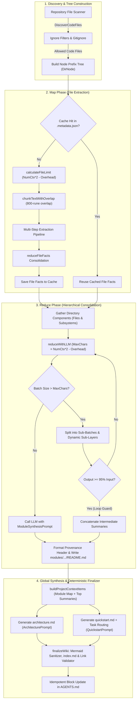

# Architecture & Map-Reduce Engine

Code-Reducer employs a multi-pass **Hierarchical Map-Reduce Strategy** paired with a **Deterministic Wiki Finalizer** and a **Pure-Go BM25 Search Engine**, engineered specifically to analyze large, multi-directory codebases using local small-parameter LLMs (such as `ornith:9b` or `gemma4:26b`) hosted on [Ollama](https://ollama.com/).

By structuring codebase extraction into discrete, context-budgeted stages followed by deterministic post-processing, Code-Reducer avoids context truncation, minimizes hallucination risk, repairs small-LLM formatting drift, and produces navigable documentation without relying on external cloud APIs.

---

## 🏗️ High-Level Map-Reduce Architecture



---

## 🌳 Node Prefix Tree (`DirNode`)

During repository discovery, Code-Reducer constructs an in-memory prefix tree representation of the codebase using the `DirNode` structure:

```go
type DirNode struct {
    Path     string
    Files    []string
    Children map[string]*DirNode
}
```

- **Path**: Virtual relative path of the directory node (e.g., `.` for repository root, `internal/engine` for subpackages).
- **Files**: Sorted list of relative file paths contained directly within this directory.
- **Children**: Map of child directory names to their nested `*DirNode` structures.

This hierarchical tree enables recursive bottom-up synthesis: leaf directories are processed first, and their generated module summaries feed directly into parent node reductions.

---

## 🔍 The Map Phase (Dynamic File Extraction)

In the Map Phase, Code-Reducer iterates over source files within affected directories to extract verifiable technical facts.

```
+-------------------------------------------------------------------------+
|                              Source File                                |
+-------------------------------------------------------------------------+
                                    |
                                    v
            +-----------------------------------------------+
            | Dynamic Context Limit:                        |
            | max(1600, NumCtx * 2 - runeCount(Overhead))   |
            | Overlap Margin: min(800, fileLimit / 4) runes |
            +-----------------------------------------------+
                                    |
            +-----------------------+-----------------------+
            |                                               |
            v                                               v
    +---------------+                               +---------------+
    | File Chunk 1  |                               | File Chunk 2  |
    +---------------+                               +---------------+
            |                                               |
            v                                               v
+-----------------------+                       +-----------------------+
| Extraction Pipeline   |                       | Extraction Pipeline   |
| 1. API_SIGNATURES     |                       | 1. API_SIGNATURES     |
| 2. BUSINESS_LOGIC     |                       | 2. BUSINESS_LOGIC     |
| 3. STATE_CONCURRENCY  |                       | 3. STATE_CONCURRENCY  |
| 4. ERRORS_SIDE_EFFECTS|                       | 4. ERRORS_SIDE_EFFECTS|
+-----------------------+                       +-----------------------+
            |                                               |
            +-----------------------+-----------------------+
                                    |
                                    v
                    +-------------------------------+
                    |   reduceFileFacts (Merge)     |
                    +-------------------------------+
                                    |
                                    v
                    +-------------------------------+
                    | Consolidated File Briefing    |
                    +-------------------------------+
```

### Context Allocation & Chunking Budget (`calculateFileLimit`)
To prevent context overflow across diverse tokenizers and languages, Code-Reducer computes chunk limits in UTF-8 runes using a conservative `maxCharsMultiplier = 2` (2 runes per context token) minus the exact rune count of the prompt overhead:

```go
const (
    defaultChunkOverlap = 800
    maxCharsMultiplier  = 2
)

func calculateFileLimit(numCtx int, sysPrompt string) int {
    limit := numCtx*maxCharsMultiplier - utf8.RuneCountInString(sysPrompt)
    if limit < defaultChunkOverlap*2 {
        return defaultChunkOverlap * 2
    }
    return limit
}
```

- **Overhead-Aware Rune Budget**: Subtracts `maxExtractionOverhead` (system prompt + language instruction + longest extraction step wrapper + target file path + sibling file list) from `numCtx * 2`.
- **Minimum Floor (`1600` runes)**: Enforces a minimum chunk size of `defaultChunkOverlap * 2` (`1600` runes) even under tiny `num_ctx` settings.
- **800-Rune Overlap Margin (`defaultChunkOverlap = 800`)**: Adjacent chunks overlap by `800` runes (automatically capped at `fileLimit / 4` when `fileLimit < 3200`) and split cleanly on newline boundaries within the final quarter of each chunk window.

### Sibling Context Injection & Multi-Step Extraction Pipeline
Every extraction prompt includes both the target file path and the directory's sibling filenames (`Directory Files: ...`) so the LLM understands intra-package boundaries without hallucinating external files. Each chunk is passed sequentially through configured `extraction_steps`:

1. `API_SIGNATURES`: Exported/public types, functions, and methods (strictly 1 line per signature).
2. `BUSINESS_LOGIC`: Maximum 5 concise bullet points describing core domain rules and logic.
3. `STATE_AND_CONCURRENCY`: Mutable package/global state, struct fields, locks, mutexes, channels, or atomics.
4. `ERRORS_AND_SIDE_EFFECTS`: External system interactions (filesystem, network, subprocesses, environment) and error handling patterns.

When a file spans multiple chunks, `reduceFileFacts` filters out empty/`None`/`N/A` responses (`isNoneFact`) and consolidates multi-chunk findings using `file_fact_consolidation_prompt` (or returns the single valid chunk directly without an extra LLM call).

---

## ⚡ The Reduce Phase (Hierarchical Consolidation)

Once file-level facts are extracted, Code-Reducer consolidates directory components (`### File: <name>` briefings and `### Subsystem: <child>` summaries) into unified directory module documentation (`<docs_dir>/modules/<module>/README.md`).

### Batch Consolidation Budget (`reduceWithLLM`)
All LLM reductions (`reduceInChunks`, `reduceFileFacts`, and `generateDoc`) share the same overhead-aware context budget via `reduceWithLLM`:

$$\text{MaxChars} = \max\left(1600,\; \text{NumCtx} \times 2 - \text{runeCount}(\text{promptOverhead})\right)$$

where `promptOverhead` includes the active system prompt, synthesis prompt, optional language instruction, batch header, and `partialBatchInstruction`.

### Dynamic Multi-Layer Map-Reduce (`reduceItems`)
When an individual component exceeds $\text{MaxChars}$, `expandOversizedItems` automatically splits the oversized item into smaller chunks (`maxChars / 2` with `maxChars / 10` overlap) before grouping items into batches:

```go
func expandOversizedItems(items []string, maxChars int) ([]string, error) {
    var expanded []string
    for _, item := range items {
        if utf8.RuneCountInString(item) <= maxChars {
            expanded = append(expanded, item)
            continue
        }
        chunks, err := chunkTextWithOverlap(item, maxChars/2, maxChars/10)
        if err != nil {
            return nil, err
        }
        expanded = append(expanded, chunks...)
    }
    return expanded, nil
}
```

### Recursion Loop Prevention Guard
If an LLM fails to condense intermediate batches (producing output $\ge 95\%$ of the input rune count), naive recursive reduction would loop infinitely. Code-Reducer halts recursion and concatenates the intermediate summaries:

```go
if countRunes(intermediate) >= (totalInputRunes * 95 / 100) {
    return strings.Join(intermediate, "\n\n"), nil
}
```

### Module Provenance Headers (`formatModuleDocument`)
Before writing each synthesized module page to `<docs_dir>/modules/<module>/README.md`, Code-Reducer deterministically prepends a structured provenance blockquote mapping the documentation page back to its directory path and sorted source files:

```markdown
> **Module:** `internal/engine` | **Source Files:** `cache.go`, `chunking.go`, `finalize.go`, `llm.go`, `orchestrator.go`, `synthesize.go`, `tree.go`
```

For parent directories that only contain subdirectories and no direct source files, the header omits the source files list (`> **Module:** \`internal\``).

---

## 🌐 Global Synthesis Phase (`GenerateStandardDocs`)

After the root directory node (`.`) is synthesized, `buildProjectContextItems` constructs a grounded global context payload containing:
1. **`## Project Directories & Module Documentation Map`**: A deterministic directory-to-doc mapping (`- \`<dir>\` -> \`modules/<dir>/README.md\` (files: ...)`).
2. **`## Root Module Summary`**: The synthesized summary of the root module (`.`).
3. **`### Top-Level Submodule: <path>`**: Synthesized summaries of every immediate child directory of the root node.

Using this context, `GenerateStandardDocs` generates two distinct root guides:

1. **System Blueprint (`<docs_dir>/architecture.md`)**:
   Generated with `architecture_prompt`, focusing on global architecture vision, system boundaries, end-to-end data flow, module interactions, and a grounded `mermaid` diagram (`flowchart TD` or `sequenceDiagram`, max 10 nodes).
2. **Developer Quickstart & Task Routing (`<docs_dir>/quickstart.md`)**:
   Generated with `quickstart_prompt`, covering prerequisites, build/install steps, CLI commands and flags, configuration (`.code-reducer.yaml` and environment variables), package structure, and a **Task Routing** table (`| Goal / Task | Module Doc | Key Source Files |`) mapping common developer tasks to module docs and source files.

---

## 🛡️ Deterministic Wiki Finalizer (`finalizeWiki`)

Small local LLMs occasionally emit unquoted special characters in Mermaid node labels or hallucinate relative link paths. After LLM generation completes in both `init` and `update` modes, `finalizeWiki` executes three deterministic, zero-LLM post-processing passes across `<docs_dir>`:

### 1. Mermaid Auto-Sanitization & Graceful Degradation (`sanitizeAndValidateMermaid`)
Scans every `.md` file in `<docs_dir>` for fenced ```` ```mermaid ```` blocks:
- **Flowchart Auto-Sanitization (`sanitizeMermaidBody`)**:
  - Automatically quotes unquoted node labels containing `():;<>`, replaces `;` with `,`, escapes `<` / `>` as `&lt;` / `&gt;`, and converts inner `"` to `'`.
  - Automatically renames the reserved Mermaid keyword `end` to `endNode` when used as a flowchart node identifier (in node definitions `end[...]` or edges `--> end` / `end -->`).
- **Heuristic Validation (`heuristicMermaidError`)**:
  - Verifies the diagram header is a supported Mermaid type (`flowchart`, `graph`, `sequencediagram`, `statediagram`, `statediagram-v2`, `classdiagram`, `erdiagram`, `gantt`, `pie`, `gitgraph`, `mindmap`, `timeline`, `journey`, `c4context`, `xychart-beta`).
  - Verifies non-empty diagram content, balanced quotes, balanced brackets/parentheses/braces, and absence of unquoted special characters or `end` node IDs.
- **Graceful Degradation**:
  - Any unclosed or invalid Mermaid block is converted into a safe ```` ```text ```` code fence preceded by an HTML diagnostic comment (`<!-- code-reducer: mermaid parse failed (<reason>) -->`), ensuring Markdown renderers never fail on broken syntax.

### 2. Deterministic Navigation Index (`generateWikiIndex`)
Generates `<docs_dir>/index.md` directly from the `DirNode` tree and `MetadataCache` without calling the LLM:
- Links to `architecture.md` and `quickstart.md` under `## Overview`.
- Lists every documented module under `## Modules` in sorted order (`- [internal/engine](modules/internal/engine/README.md) — <first prose sentence up to 140 runes> (7 files: cache.go, ...)`).

### 3. Internal Markdown Link & `#anchor` Validation / Auto-Repair (`validateMarkdownLinks`)
Walks all Markdown files in `<docs_dir>` (ignoring links inside fenced code blocks and inline code spans):
- **Idempotent Cleanup**: Strips any previously stamped `<!-- code-reducer: broken internal link ... -->` comments before re-validating.
- **Automatic Relative Link Repair (`tryAutoRepairLink`)**: If a relative link target does not exist at its literal path, Code-Reducer checks candidate paths under `<docs_dir>/modules/<target>`, `<docs_dir>/modules/<target>/README.md`, and `<docs_dir>/<target>/README.md`. When an unambiguous match exists inside the repository sandbox, the link href is rewritten in-place to the correct relative path.
- **Heading Anchor Verification**: For links targeting `.md` files with `#anchor` fragments (excluding line-number anchors like `#L10-L20`), verifies the slug exists in the target file's ATX headings.
- **Diagnostic Stamping**: Any remaining broken file link, non-portable root-absolute link (`/path`), or missing `#anchor` is stamped above the line with `<!-- code-reducer: broken internal link [target] <reason> -->`.

---

## 🤖 Idempotent AI Agent Guidelines (`AGENTS.md`)

In Step 5 of `code-reducer init`, `updateAgentGuidelines` writes or updates `AGENTS.md` in the repository root using bounded HTML comment markers (`<!-- CODE-REDUCER:START -->` and `<!-- CODE-REDUCER:END -->`):

```markdown
<!-- CODE-REDUCER:START -->
# AI Agent Guidelines

This repository contains automatically generated documentation under the wiki directory to help AI coding agents understand the system architecture, design patterns, and module structure:

- **System Blueprint**: Refer to wiki/architecture.md for a high-level system overview, module relationships, and boundary definitions.
- **Developer Quickstart & Task Routing**: Refer to wiki/quickstart.md for onboarding steps, task routing table, coding patterns, and configuration settings.
- **Documentation Index**: Refer to wiki/index.md for a navigable catalog of all system and module pages.
- **Module Details**: Explore wiki/modules/ for directory-level summaries and API descriptions of internal packages.
- **CLI Search & Read**: Run `code-reducer search "<query>"` and `code-reducer read "<page#section>"` to query the documentation directly.
<!-- CODE-REDUCER:END -->
```

- If `AGENTS.md` does not exist, it is created with the marker block.
- If `AGENTS.md` already contains `<!-- CODE-REDUCER:START --> ... <!-- CODE-REDUCER:END -->`, only the content between the markers is replaced in-place, preserving any custom human or agent instructions outside the block.

---

## 🔎 Pure-Go BM25 Section Search & Reader (`internal/search`)

Code-Reducer includes a zero-dependency, pure-Go search and retrieval engine in `internal/search` (exposed via `code-reducer search` and `code-reducer read`) so developers and AI agents can query specific documentation sections without loading the entire wiki into context.

### Section-Granular Indexing (`parseMarkdownSections`)
1. **File Discovery**: Walks `<docs_dir>` for `.md` files, skipping hidden files/directories (e.g., `.metadata.json`) and the navigation catalog `index.md`.
2. **Heading Segmentation**: Splits each Markdown document into sections at `#` (H1) and `##` (H2) ATX headings (automatically falling back to `###` H3 if a document has no H2 headings), while ignoring `#` lines inside fenced code blocks.
3. **Provenance Extraction (`parseProvenance`)**: Parses the `> **Module:** \`<path>\` | **Source Files:** \`f1\`, \`f2\`` header on module pages to associate every section in that module with its underlying source file names and directory path.
4. **CamelCase & Identifier Tokenization (`tokenize`)**: Splits tokens on non-alphanumeric boundaries and decomposes camelCase/PascalCase/acronym identifiers (e.g., `SearchWiki` $\rightarrow$ `searchwiki`, `search`, `wiki`).

### Weighted Okapi BM25 Ranking (`scoreAndRankSections`)
Each section is scored against unique query tokens using Okapi BM25 ($k_1 = 1.2$, $b = 0.75$) with field-specific term-frequency weights:

$$\text{TF}(t, s) = 3.0 \times \text{tf}_{\text{title}}(t, s) + 2.0 \times \text{tf}_{\text{sources}}(t, s) + 1.0 \times \text{tf}_{\text{body}}(t, s)$$

- **Title Weight ($3.0\times$)**: Matches in the page path and section heading.
- **Source Provenance Weight ($2.0\times$)**: Matches in the module's directory path and `Source Files` list.
- **Body Weight ($1.0\times$)**: Matches in the section prose and tables.
- **Multi-Term Coverage Bonus**: Sections matching $m > 1$ distinct query tokens receive a multiplicative boost of $1 + 0.25 \times (m - 1)$.
- **Source-Path Hint Boosting (`--path` / `-p`)**: When path hints are supplied (e.g., `--path internal/engine` or `-p finalize.go`), sections whose page path, module path, or provenance source files match any hint receive a **$2.0\times$ score multiplier** (`pathHintBoost = 2.0`).

### Safe Section Reader (`ReadWikiSection`)
`code-reducer read <page[#section]>` resolves targets relative to `<docs_dir>` using `security.SafeResolve`:
- Automatically strips a leading `<docs_dir>/` prefix if provided (so both `architecture.md` and `wiki/architecture.md` work seamlessly).
- Rejects path traversal outside `<docs_dir>`, hidden dot-files (such as `.metadata.json`), and non-Markdown files.
- When `#anchor` is omitted, returns the full Markdown page; when `#anchor` is specified, extracts the matching heading and all nested content up to the next heading of equal or higher level (or lists available anchors if not found).
