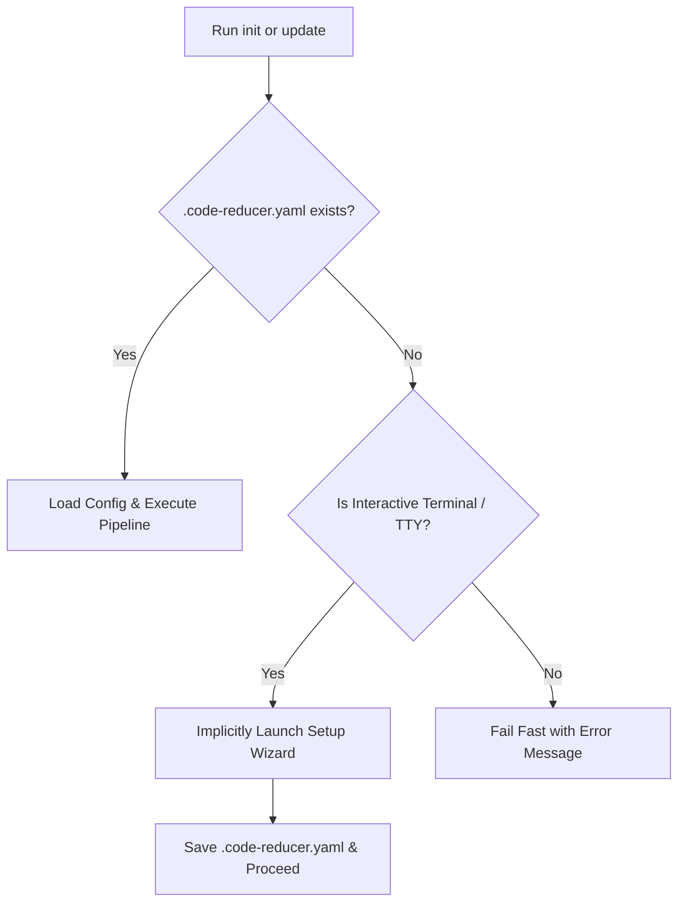

# CLI Commands & Setup Wizard

Code-Reducer provides a streamlined command-line interface (CLI) for configuring, initializing, updating, searching, and reading codebase wikis. This document details all five CLI subcommands, interactive wizard behaviors, implicit setup detection, and runtime parameter overrides.

---

## CLI Subcommands Reference

Code-Reducer provides five subcommands:

```text
code-reducer [subcommand] [flags]
```

### 1. `code-reducer setup`

Launches the interactive terminal setup wizard to create or update `.code-reducer.yaml`.

```bash
code-reducer setup
```

- **Purpose**: Interactively prompts for model selection, Ollama endpoint URL, context window size, ignore patterns, documentation output directory, and output language.
- **Behavior**: Reads existing `.code-reducer.yaml` if present and supplies current settings as prompt defaults. Saves the resulting configuration with `0600` permissions.

---

### 2. `code-reducer init`

Generates the initial repository documentation set, deterministic navigation index, and metadata cache.

```bash
code-reducer init [--model-id <model>] [--num-ctx <size>] [--language <lang>]
```

- **Purpose**: Performs full codebase discovery, builds the hierarchical `DirNode` tree, extracts facts across files, synthesizes directory module summaries alongside root blueprints, runs `finalizeWiki`, and updates `AGENTS.md`.
- **Artifacts Created**:
  - `<docs_dir>/modules/<module>/README.md` (Directory module docs with `> **Module:** ... | **Source Files:** ...` provenance headers).
  - `<docs_dir>/architecture.md` (Global system architecture blueprint with Mermaid diagram).
  - `<docs_dir>/quickstart.md` (Developer onboarding guide with Task Routing table).
  - `<docs_dir>/index.md` (Deterministic navigation index of all overview and module pages).
  - `<docs_dir>/.metadata.json` (SHA256 hash, facts, module summary, and `steps_hash` cache).
  - `AGENTS.md` (Root AI agent navigation guide updated idempotently inside `<!-- CODE-REDUCER:START --> ... <!-- CODE-REDUCER:END -->` markers).
- **Constraints**: Fails fast if `<docs_dir>/.metadata.json` already exists. Use `update` for existing projects.

---

### 3. `code-reducer update`

Performs a smart incremental documentation update targeting only modified files with changed facts and affected modules.

```bash
code-reducer update [--model-id <model>] [--num-ctx <size>] [--language <lang>]
```

- **Purpose**: Computes SHA256 hashes of current repository files, compares them against `<docs_dir>/.metadata.json`, prunes stale cache entries and orphaned module docs, and rebuilds only impacted modules.
- **Smart Incremental Short-Circuiting**:
  - **Fact-Level Short-Circuit**: When a file's SHA256 changes, Code-Reducer extracts its new facts and compares them to the cached `Facts`. If unchanged (e.g. comment or formatting edits), module re-synthesis and upward propagation are skipped.
  - **Global Docs Short-Circuit**: Skips regenerating `architecture.md` and `quickstart.md` if all global docs exist, no files were added or deleted, and both the root summary (`.`) and top-level child module summaries are unchanged.
- **Cache Invalidation (`steps_hash`)**: Detects changes in `model_id`, `language`, any synthesis/system prompt, or `extraction_steps` and automatically invalidates outdated cache entries to force a clean rebuild.
- **Deterministic Finalization**: Runs `finalizeWiki` to sanitize Mermaid blocks, refresh `<docs_dir>/index.md`, and auto-repair/validate internal Markdown links and `#anchor` fragments.
- **Constraints**: Fails fast if the project has not been initialized yet (`code-reducer init` required).

---

### 4. `code-reducer search`

Searches generated documentation sections using pure-Go Okapi BM25 ranking and returns section targets ready for `code-reducer read`.

```bash
code-reducer search <query> [--path|-p <path>] [--limit|-n <limit>]
```

- **Flags**:
  - `--path`, `-p` (`[]string`): Boost sections whose page path, module path, or provenance source files match the given path hint ($2.0\times$ score multiplier). Can be specified multiple times or comma-separated.
  - `--limit`, `-n` (`int`, default `5`): Maximum number of ranked section results to return.
- **Output Format**: Displays the rank, target (`<page>#<anchor>`), BM25 score, section heading, provenance source files (when present), and a matching prose snippet:

```text
$ code-reducer search "mermaid sanitization" -p internal/engine -n 3
[1] modules/internal/engine/README.md#deterministic-finalizer (score: 9.42)
    Heading: Deterministic Finalizer
    Sources: cache.go, chunking.go, finalize.go, llm.go, orchestrator.go, synthesize.go, tree.go
    Snippet: sanitizeAndValidateMermaid extracts fenced mermaid blocks, quotes special labels, and degrades invalid diagrams.
```

---

### 5. `code-reducer read`

Reads a full documentation page or a specific heading section from `<docs_dir>`.

```bash
code-reducer read <page[#section]>
```

- **Purpose**: Prints the Markdown content of a full wiki page or extracts a specific ATX heading section (and its nested subsections) by GitHub-style slug anchor.
- **Examples**:
  ```bash
  # Read an entire root documentation page
  code-reducer read architecture.md

  # Read a specific section from a module documentation page
  code-reducer read modules/internal/engine/README.md#synthesis-pipeline
  ```
- **Security**: Validates the target path with `security.SafeResolve`, strips any redundant `<docs_dir>/` prefix automatically, blocks path traversal outside `<docs_dir>`, and refuses to read hidden dot-files (such as `.metadata.json`) or non-`.md` files. If a requested `#anchor` does not exist, it returns an error listing all available anchors in that file.

---

## Interactive Setup Wizard Flow

Running `code-reducer setup` initiates an interactive step-by-step terminal prompt flow:

```text
Welcome to Code-Reducer CLI Setup
---------------------------------
Enter LLM Model ID [ornith:9b]: 
Enter Ollama Base URL [http://localhost:11434]: 
Enter Ollama Context Size [8192]: 20000
Enter directories, files, or patterns to ignore (comma-separated): screenshots, docs, examples
Enter documentation directory [wiki]: 
Enter Output Language (leave empty for default English): 
Configuration successfully saved to local .code-reducer.yaml file.
```

### Prompt Sequence & Defaults

1. **LLM Model ID**: Model loaded into local Ollama (Default: `ornith:9b`).
2. **Ollama Base URL**: API endpoint URL (Default: `http://localhost:11434`).
3. **Context Size (`num_ctx`)**: Context window in tokens (Default: `8192`).
4. **Ignore Patterns**: Comma-separated list of files, directories, or glob patterns to ignore. Entering `clear` or `none` empties existing custom ignore lists.
5. **Documentation Directory**: Output directory for generated docs (Default: `wiki`).
6. **Output Language**: Target natural language for documentation prose and headings (Default: `""` for English; e.g. `Spanish`, `French`, `es`).

If `.code-reducer.yaml` already exists when `setup` is executed, the wizard populates every prompt default using values from the existing YAML file.

---

## Implicit Wizard Launching

If you run `code-reducer init` or `code-reducer update` in a workspace where `.code-reducer.yaml` does not exist, Code-Reducer handles setup dynamically based on your terminal environment:



### Terminal (TTY) vs Non-Interactive (CI/CD)

- **Interactive TTY**: If `stdin` is attached to a terminal, Code-Reducer automatically pauses execution, runs `RunSetupFlow()`, writes `.code-reducer.yaml`, and seamlessly proceeds with `init` or `update`.
- **Non-TTY / CI Pipeline**: If `stdin` is detached (e.g. Docker build or GitHub Actions), Code-Reducer halts immediately with an error:

```text
Error: configuration file .code-reducer.yaml does not exist in the current directory. Please run 'code-reducer setup' to configure the application
```

---

## Parameter Overrides via CLI Flags & Environment Variables

You can override configuration values at runtime without modifying `.code-reducer.yaml`.

### CLI Persistent Flags

Code-Reducer accepts persistent flags across commands:

| Flag | Type | Description | Example |
| :--- | :--- | :--- | :--- |
| `--model-id` | `string` | Override LLM model ID | `--model-id gemma4:26b` |
| `--num-ctx` | `string` | Override Ollama context window size | `--num-ctx 16384` |
| `--language` | `string` | Override target language for generated docs | `--language Spanish` |

#### Flag Examples

```bash
# Run initial analysis using a larger model, 16k context window, and Spanish output
code-reducer init --model-id gemma4:26b --num-ctx 16384 --language Spanish

# Run incremental update overriding only the model
code-reducer update --model-id ornith:9b
```

### Environment Variable Overrides

Environment variables override values in `.code-reducer.yaml` but yield to explicit CLI flags:

| Environment Variable | Target Parameter | Description |
| :--- | :--- | :--- |
| `CODE_REDUCER_MODEL_ID` | `model_id` | Overrides the LLM model ID. |
| `CODE_REDUCER_LANGUAGE` | `language` | Overrides the target output language. |
| `OLLAMA_BASE_URL` | `ollama_base_url` | Overrides the Ollama API server URL. |
| `OLLAMA_NUM_CTX` | `ollama_num_ctx` | Overrides the Ollama context window size. |

#### Environment Variable Examples

```bash
# Point to a remote Ollama server instance and set output language
export OLLAMA_BASE_URL="http://192.168.1.100:11434"
export CODE_REDUCER_MODEL_ID="gemma4:26b"
export CODE_REDUCER_LANGUAGE="English"
export OLLAMA_NUM_CTX=32768

code-reducer update
```
