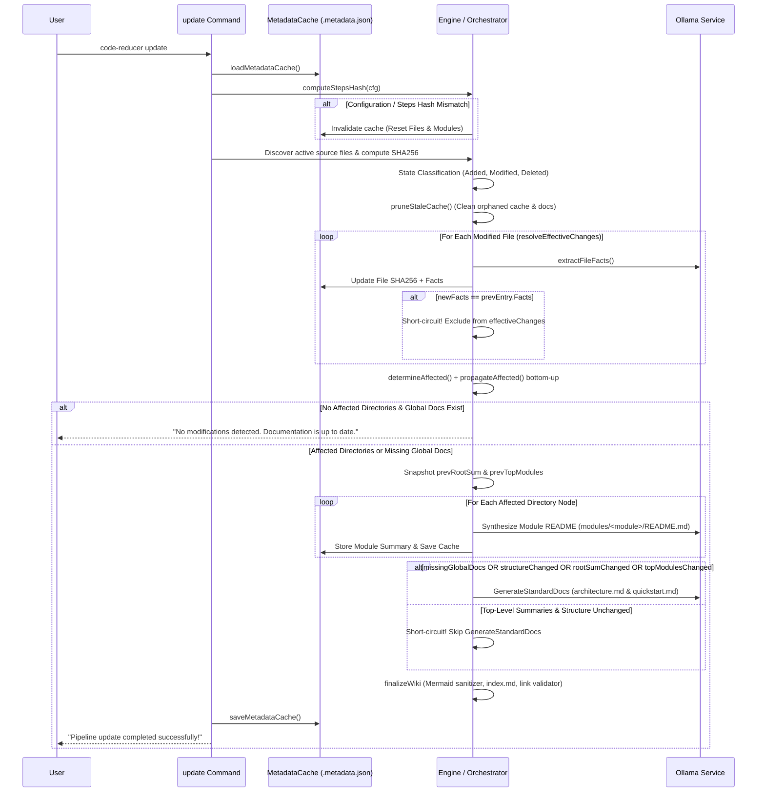

# Incremental Updates & Map-Reduce Caching

To avoid re-analyzing an entire codebase every time a minor file changes, **Code-Reducer** implements a lightweight, platform-independent caching engine backed by filesystem SHA256 content hashing, **Smart Incremental Short-Circuiting**, and bottom-up state propagation.

Running `code-reducer update` selectively re-processes only modified source files whose extracted facts actually change, and skips global documentation regeneration when top-level summaries and directory structure remain unchanged.

---

## ⚡ Incremental Workflow (`code-reducer update`)

When `code-reducer update` is executed, the pipeline performs the following sequence:



---

## 🔑 Hash-Based State Tracking (`.metadata.json`)

Documentation cache state is persisted inside the designated output folder (e.g. `wiki/.metadata.json`).

### Metadata Cache Schema

```json
{
  "version": 1,
  "steps_hash": "a5d8f7b3c2e1...",
  "files": {
    "internal/engine/orchestrator.go": {
      "sha256": "e3b0c44298fc1c149afbf4c8996fb92427ae41e4649b934ca495991b7852b855",
      "facts": "#### [API_SIGNATURES]\n..."
    }
  },
  "modules": {
    "internal/engine": "Synthesized module summary markdown content..."
  }
}
```

### Platform-Independent SHA256 Content Hashing
File change detection relies on direct binary content SHA256 computation rather than operating system modification timestamps (`mtime`) or Git commit history:

```go
func computeSHA256(repoRoot, virtualPath string) (string, error) {
    content, err := tools.ReadFileSafely(repoRoot, virtualPath)
    if err != nil {
        return "", err
    }
    hash := sha256.Sum256(content)
    return hex.EncodeToString(hash[:]), nil
}
```

This guarantees identical behavior across operating systems (Linux, macOS, Windows) and avoids invalidating caches when files are checked out or touched without content modifications.

---

## 📊 File State Classification & Stale Cache Pruning

During `detectFileChanges`, active repository files discovered by `DiscoverCodeFiles` are compared against `cache.Files`:

| Classification | Condition | Action Taken |
| :--- | :--- | :--- |
| **`Added`** | Present in workspace, missing from `cache.Files`. | Sets `structureChanged = true`. Directory containing file marked **affected**. Full Map extraction triggered for file. |
| **`Modified`** | Present in both workspace and cache, but current SHA256 $\neq$ cached SHA256. | Evaluates new facts via `resolveEffectiveChanges`. Directory marked **affected** only if extracted facts changed. |
| **`Deleted`** | Present in `cache.Files`, missing from active workspace. | Sets `structureChanged = true`. Immediate parent directory marked **affected**. Pruned from `cache.Files` and orphaned module docs deleted via `pruneStaleCache`. |

---

## 🧠 Smart Incremental Update Short-Circuit

Code-Reducer employs a two-stage short-circuit mechanism during `code-reducer update` to avoid unnecessary upward cascade re-synthesis and redundant global doc generation:

### 1. Fact-Level Short-Circuit (`resolveEffectiveChanges`)
When a file's SHA256 hash changes (`StatusModified`)—for instance, due to code formatting, comment edits, or internal implementation tweaks that do not alter the extracted facts—rebuilding its module documentation and every parent directory up to the root would waste LLM inference calls.

Before propagating affected directories, `resolveEffectiveChanges` extracts the modified file's updated facts and compares them directly against the previously cached `Facts` string:

```go
if change.Status == StatusModified {
    if prevEntry, ok := pState.cache.Files[change.Path]; ok {
        var siblingFiles []string
        if dirNode := nodesByPath[path.Dir(change.Path)]; dirNode != nil {
            siblingFiles = dirNode.Files
        }
        newFacts, err := extractFileFacts(ctx, pState, change.Path, siblingFiles)
        if err != nil {
            return nil, false, err
        }
        if newFacts == prevEntry.Facts {
            pState.onStatus(fmt.Sprintf("➜ Unchanged facts for modified file, skipping module re-synthesis: %s", change.Path))
            continue
        }
    }
}
```

If `newFacts == prevEntry.Facts`, the file's new SHA256 is saved in `cache.Files`, the change is omitted from `effectiveChanges`, and **zero module or parent directory re-synthesis calls are triggered** for that file.

### 2. Global Documentation Short-Circuit (`GenerateStandardDocs` Skip)
Because `architecture.md` and `quickstart.md` are synthesized from the project directory map, the root summary (`.`), and top-level child module summaries (`tree.Children`), `RunUpdate` snapshots those summaries prior to hierarchical reduction.

After `synthesizeNode` finishes, Code-Reducer only runs `GenerateStandardDocs` if at least one of the following holds:
- Any global doc (`architecture.md`, `quickstart.md`, or `index.md`) is missing on disk (`missingGlobalDocs`).
- Files were added or deleted (`structureChanged`).
- The root module summary changed (`rootSum != prevRootSum`).
- Any top-level child module summary changed (`topModulesChanged`).

Otherwise, it logs `"➜ Skipping global docs regeneration (top-level summaries unchanged)"` and jumps directly to `finalizeWiki`.

---

## 🌲 Bottom-Up Change Propagation

When an effective change alters a file's extracted facts (or adds/deletes a file), child module changes must reflect in parent module documentation. Code-Reducer achieves this through two-phase affect determination:

### 1. Direct Affect Evaluation (`determineAffected`)
A directory node `n` is directly marked **affected** if:
- Any file in `n.Files` is in `effectiveChanges` (`Added` or `Modified` with changed facts).
- Any file associated with `n.Path` was `Deleted`.
- The directory's module documentation file (`<docs_dir>/modules/<module>/README.md`) is physically missing on disk.
- The directory entry `cache.Modules[n.Path]` is missing.

### 2. Recursive Bottom-Up Propagation (`propagateAffected`)
Once direct affects are identified, `propagateAffected` performs a post-order traversal up the tree:

```go
func propagateAffected(node *DirNode, affectedDirs map[string]bool) map[string]bool {
    newAffected := make(map[string]bool)
    for k, v := range affectedDirs {
        newAffected[k] = v
    }

    var propagate func(*DirNode) bool
    propagate = func(n *DirNode) bool {
        isAffected := newAffected[n.Path]
        for _, child := range n.Children {
            if propagate(child) {
                isAffected = true
            }
        }
        if isAffected {
            newAffected[n.Path] = true
        }
        return isAffected
    }
    propagate(node)
    return newAffected
}
```

If `internal/engine/chunking.go` has modified facts:
1. `internal/engine` is marked directly affected.
2. Propagation marks `internal` affected.
3. Propagation marks `.` (root) affected.
4. Sibling branches outside `internal` (e.g. `cmd/`) remain **unaffected** and reuse their cached summaries.

---

## 🔄 Configuration & Prompt Cache Invalidation (`steps_hash`)

If you change the LLM model, switch output languages, edit any synthesis prompt, or modify the `extraction_steps` pipeline in `.code-reducer.yaml`, previously cached facts and module summaries become stale.

Code-Reducer tracks full generation configuration evolution by computing a null-delimited SHA256 digest (`computeStepsHash`) covering `ModelID`, `Language`, all five synthesis/system prompts, and every `ExtractionStep`:

```go
func computeStepsHash(cfg *config.Config) string {
    h := sha256.New()
    writeField := func(s string) {
        h.Write([]byte(s))
        h.Write([]byte{0})
    }
    writeField(cfg.ModelID)
    writeField(cfg.Language)
    writeField(cfg.SystemPrompt)
    writeField(cfg.ModuleSynthesisPrompt)
    writeField(cfg.ArchitecturePrompt)
    writeField(cfg.QuickstartPrompt)
    writeField(cfg.FileFactConsolidationPrompt)
    for _, step := range cfg.ExtractionSteps {
        writeField(step.Name)
        writeField(step.Prompt)
    }
    return hex.EncodeToString(h.Sum(nil))
}
```

During `code-reducer update`:
1. `currentStepsHash` is calculated from the resolved runtime configuration.
2. If `cache.StepsHash != currentStepsHash`:
   - A warning event is logged: `"Warning: Extraction steps changed. Invalidating metadata cache to force full documentation regeneration."`
   - `cache.Files` and `cache.Modules` are cleared in memory.
   - `cache.StepsHash` is updated to `currentStepsHash`.
3. All files and directories are marked affected, forcing a clean, deterministic rebuild of the entire documentation suite.
