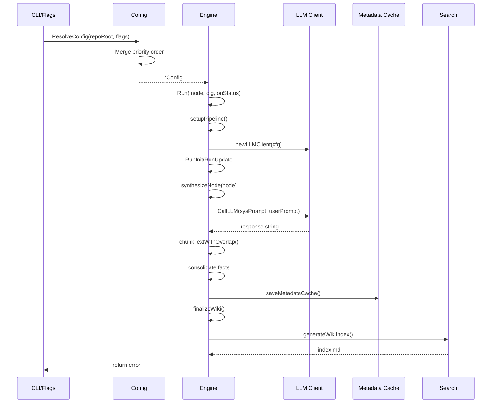

# Architecture

## System Overview

Code-Reducer is a CLI documentation agent that synthesizes structured markdown from source code through a Map-Reduce pipeline. The system discovers code files, builds a hierarchical directory tree, computes SHA-256 hashes for change detection, and generates documentation hierarchically via tree-merging. A versioned metadata cache enables incremental regeneration without reprocessing unaffected modules.

## Module Boundaries

| Module | Responsibility |
|--------|---------------|
| `cmd` | CLI surface: registers cobra commands (`init`, `read`, `search`, `setup`, `update`) under shared `RootCmd` |
| `internal/config` | Configuration loading/resolution/persistence with multi-source merge (defaults → YAML → env vars → CLI flags) |
| `internal/engine` | Orchestrates LLM-based synthesis: file discovery, tree building, hash computation, hierarchical synthesis, finalization |
| `internal/search` | BM25 full-text search over generated markdown sections with path-hint boosting |
| `internal/security` | Path-traversal-safe resolution and atomic process locking via `O_EXCL` |
| `internal/tools` | Safe filesystem I/O, git verification, markdown parsing (fence/heading extraction) |

## End-to-End Data Flow

## Configuration Resolution

Configuration merges four sources in priority order: system defaults → YAML config file → environment variables → CLI flags. The `Config` struct holds LLM backend settings (Ollama model ID, base URL, context size), document directory paths, language overrides, system prompts, extraction step definitions, and ignore lists.

## Synthesis Pipeline

The orchestrator maintains pipeline state (LLM client, repo root, config, metadata cache, affected directories, precalculated hashes, status callback) set once per run. A custom lock from `security.AcquireLock` is acquired at pipeline start and released via `defer`.

### Initialization and Update Modes

- **`ModeInit`**: Scans repository, builds initial wiki markdown pages
- **`ModeUpdate`**: Scans for files modified since last documented commit

Both modes discover code files, build directory trees, compute SHA-256 hashes, and compare against cached values to identify added/modified/deleted files.

### Hierarchical Synthesis

`synthesizeNode()` recursively traverses the directory tree: child directories first, then individual files. File processing uses chunking with configurable overlap. Extraction results are cached by file hash to avoid redundant LLM invocations. Module summaries are persisted to the metadata cache and reused when downstream directories are unaffected.

## LLM Communication

`CallLLM()` sends JSON array of messages to Ollama `/api/chat` via HTTP POST with 10-minute timeout. Request includes model ID, system and user messages, options with `num_ctx` and fixed temperature 0.1. Response truncation detected when `done_reason` equals "length" triggers warning callback.

## Finalization

Deterministic post-processing: sanitizes Mermaid diagram blocks (degrades broken blocks to text fences), generates `index.md` navigation entrypoint linking to architecture, quickstart, and all documented modules. Relative module/doc links auto-repaired when unambiguous.

## Search

`SearchWiki` walks docs directory tree, parses `.md` files into sections (skipping fenced code blocks), scores sections via BM25 (k1=1.2, b=0.75), applies path-hint score boosts for matching module paths, extracts query-matched prose snippets truncated to 160 runes. Returns top `limit` results ranked by score.

## Security Model

All filesystem operations route through `security.SafeResolve` before touching the OS. Path resolution validates resolved paths remain within repository root after symlink evaluation. Lock acquisition uses atomic file creation with `O_EXCL` to prevent concurrent acquisition by multiple processes.

## Error Handling

Fail-fast pattern: functions return immediately on error without recovery or retry. Errors wrapped with `fmt.Errorf("...: %w", err)` for context preservation. HTTP errors fail fast without retries, limiting response bodies to 1024 bytes. Context cancellation checked via `ctx.Err()` at start of `reduceItems` and after each batch.

## Concurrency

No synchronization primitives (locks, mutexes, channels, atomics) in `internal/config` or `internal/engine`. `internal/security.SimpleLock` uses `sync.Mutex` to protect `Unlock`. `internal/tools.NextHeadingAnchor` mutates `seenCounts` map without synchronization; callers manage concurrent access externally.