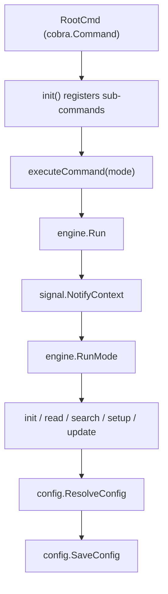

> **Module:** `cmd` | **Source Files:** `init.go`, `read.go`, `root.go`, `search.go`, `setup.go`, `update.go`

# cmd Module — Technical Documentation

## Module Responsibility

The `cmd` package implements the CLI surface for the Code-Reducer documentation agent. It registers cobra commands (`init`, `read`, `search`, `setup`, `update`) under a shared `RootCmd` and delegates execution to a single `executeCommand` function parameterized by an `engine.RunMode`. The entry point requires a valid Git repository; if no configuration file exists and stdin is a terminal, an interactive setup flow runs automatically.

## Data Flow

## Command Registration

All commands are package-level `*cobra.Command` pointers initialized once in `init()` and never mutated afterward.

| Command | Purpose | Mode Constant |
|---------|---------|---------------|
| `init` | Initialize project documentation; scans repository and builds initial wiki markdown pages | `engine.ModeInit` |
| `read` | Read documentation pages or specific heading sections from the generated wiki repository | — |
| `search` | Search wiki markdown pages at section granularity using BM25 ranking | — |
| `setup` | Interactive CLI setup; prompts for LLM Model ID, Ollama Base URL, Context Size, Ignore patterns, Documentation directory, Output Language | — |
| `update` | Incremental documentation updates; scans for files modified since the last documented commit | `engine.ModeUpdate` |

## Flag State

Package-level mutable state is set via cobra flag registration in `init()` and is not modified by downstream functions.

| Flag | Type | Registration |
|------|------|--------------|
| `modelIDFlag` | `string` | `StringVar` |
| `numCtxFlag` | `int` | `IntVar` |
| `languageFlag` | `string` | `StringVar` |
| `searchPathHintsFlag` | `[]string` | `StringSliceVarP` |
| `searchLimitFlag` | `int` | `IntVarP` |

## Configuration Resolution

`config.ResolveConfig()` reads and validates configuration from the filesystem, resolving model ID, context size, and language flags. Errors are returned directly to the caller.

## Setup Flow

`RunSetupFlow(repoRoot)` loads any existing `.code-reducer.yaml` configuration, applies defaults, and merges user inputs before persisting the final configuration via `config.SaveConfig`. The function accepts a `bufio.Reader` parameter to support non-interactive testing. Invalid or empty input falls back to existing values or defaults (e.g., `"clear"`/`"none"` clears ignore lists).

## Error Handling

The module follows a fail-fast pattern: functions return immediately on error without recovery or retry logic. All errors are wrapped with `fmt.Errorf("...: %w", err)` for context preservation in call chains. `fmt.Fprint`/`fmt.Fprintln` return values are ignored (no error handling).

## Filesystem Interactions

| Operation | Function | Notes |
|-----------|----------|-------|
| Read current working directory | `os.Getwd()` | Errors wrapped with `%w` |
| Read configuration files | `config.ResolveConfig()` | Paths inferred from `internal/config` |
| Read wiki markdown files | `search.SearchWiki` / `search.ReadWikiSection()` | Reads from `cfg.DocsDir` |
| Persist configuration | `config.SaveConfig` | Errors wrapped with `%w` |
| Validate Git repository | `tools.VerifyGitRepo()` | Fail-fast on invalid repo |
| Check configuration file presence | `config.ConfigExists()` | Used by `checkAndRunSetup` |

## Signal Handling

`signal.NotifyContext` wraps `context.Background()` for SIGINT/SIGTERM handling in `runEngine`. Cleanup is deferred via `defer stop()`.

## Terminal Detection

`isatty.IsTerminal(os.Stdin.Fd())` and `isatty.IsCygwinTerminal(os.Stdin.Fd())` detect an interactive terminal environment, gating the setup flow in `checkAndRunSetup`.

## External Dependencies

`executeCommand` and `engine.ModeInit`/`engine.ModeUpdate` are external references not defined in this package. Their behavior is unverifiable from this source alone.