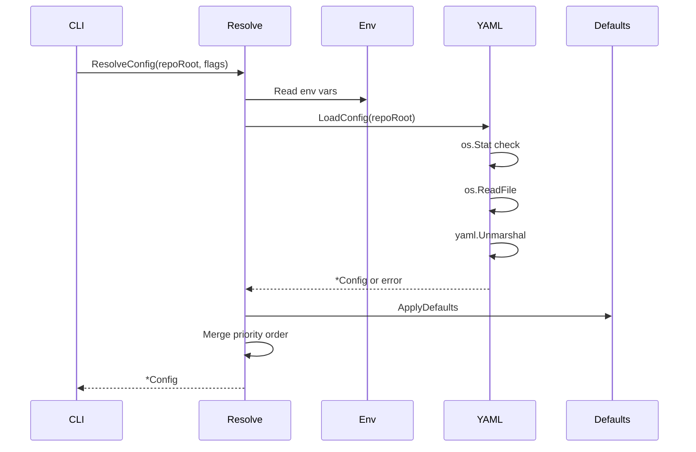
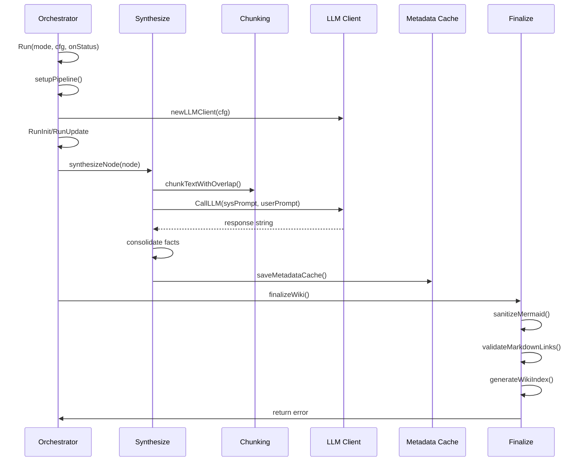
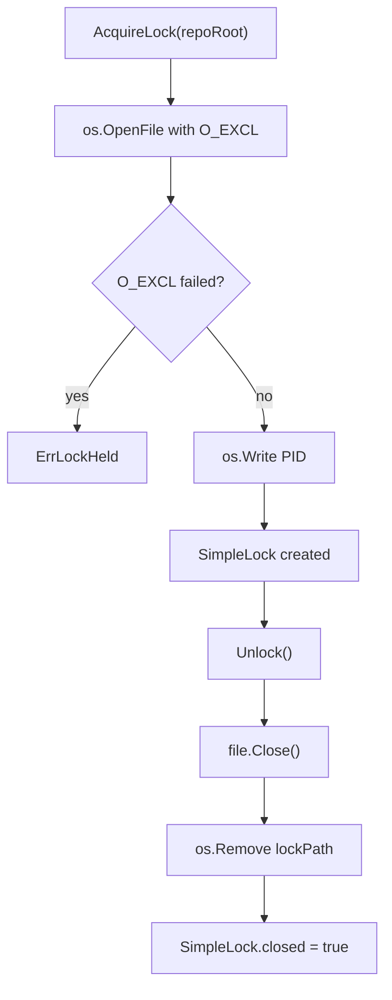
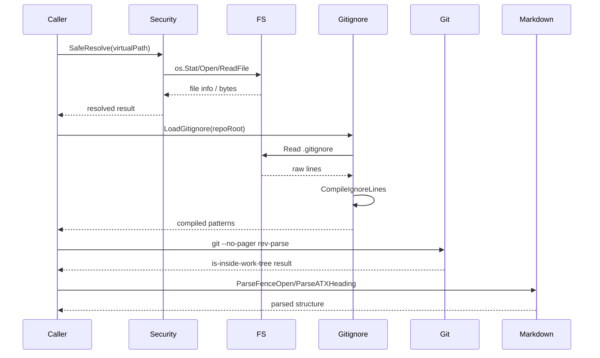

> **Module:** `internal`

# Code-Reducer Architecture

## Overview

Code-Reducer synthesizes structured documentation from source code through a Map-Reduce pipeline orchestrated by the `internal/engine` package. The system discovers source files, builds a hierarchical directory tree, computes SHA-256 hashes for change detection, and synthesizes documentation hierarchically via tree-merging. A versioned metadata cache enables incremental regeneration.

## Subsystem: config

### Responsibility

The `internal/config` module provides configuration loading, resolution, and persistence. It supports multiple configuration sources merged in priority order: system defaults, YAML config file, environment variables, and CLI flags. The module manages LLM backend configuration (Ollama), document directory paths, language overrides, extraction step definitions, and system prompts used across synthesis phases.

### Configuration Resolution



### Configuration Schema

The `Config` struct holds all configuration state with YAML tags for serialization. Fields include:

- **LLM Backend**: `model_id`, `ollama_base_url`, `ollama_num_ctx`
- **Paths**: `docs_dir`, `config_file_path` (derived)
- **Language**: `language` (optional, omitted when empty)
- **Prompts**: `system_prompt`, `module_synthesis_prompt`, `architecture_prompt`, `quickstart_prompt`, `file_fact_consolidation_prompt`
- **Extraction Steps**: `extraction_steps` ([]ExtractionStep)
- **Ignore List**: `ignore` ([]string)

### Constants and Defaults

| Constant | Value |
|---|---|
| `CodeReducerModelIDEnvKey` | `"CODE_REDUCER_MODEL_ID"` |
| `CodeReducerLanguageEnvKey` | `"CODE_REDUCER_LANGUAGE"` |
| `OllamaBaseURLEnvKey` | `"OLLAMA_BASE_URL"` |
| `OllamaNumCtxEnvKey` | `"OLLAMA_NUM_CTX"` |
| `OllamaDefaultBaseURL` | `"http://localhost:11434"` |
| `OllamaDefaultModelID` | `"ornith:9b"` |
| `OllamaDefaultNumCtx` | `8192` |
| `DefaultDocsDir` | `"wiki"` |
| `ConfigFileName` | `".code-reducer.yaml"` |
| `configFilePerm` | `0600` |

### Extraction Steps

The `ExtractionStep` struct defines analysis phases with `Name` and `Prompt` fields. The default extraction sequence consists of four phases:

1. **API_SIGNATURES** — Extract public API surface (types, functions, methods)
2. **BUSINESS_LOGIC** — Define configuration schema and defaults
3. **STATE_AND_CONCURRENCY** — Analyze state and concurrency patterns
4. **ERRORS_AND_SIDE_EFFECTS** — Analyze external I/O and error propagation

Each phase specifies output constraints and falls back to `"None"` when no applicable items exist.

### File I/O Operations

The `internal/config/io.go` file provides three public functions:

- **`ConfigExists(cwd string) bool`** — Checks whether the configuration file exists at the resolved path using `os.Stat`.
- **`LoadConfig(cwd string) (*Config, error)`** — Reads the YAML file via `os.ReadFile`, unmarshals into `Config`, and returns nil config on read failure. Wraps parse errors with `"failed to parse yaml config: %w"`.
- **`SaveConfig(cwd string, cfg *Config) error`** — Marshals `Config` to YAML, applies formatting rules (blank lines before specific keys), and writes atomically via `tools.WriteFileAtomic` with `configFilePerm`.

### Configuration Resolution

The `internal/config/resolve.go` file provides `ResolveConfig(repoRoot, modelIDFlag, numCtxFlag, languageFlag string) (*Config, error)`. Resolution merges sources in priority order:

1. System defaults (empty/zero fields)
2. YAML config file (via `LoadConfig`)
3. Environment variables (via `os.Getenv`)
4. CLI flags

Key behaviors:

- **`ApplyDefaults`** — Sets `ModelID`, `OllamaBaseURL`, `OllamaNumCtx`, `DocsDir`, `Language`, all prompt fields, and `ExtractionSteps` from constants when empty or zero.
- **`ResolveConfig`** — Deduplicates the `Ignore` slice, validates `numCtx` as positive integer via `parsePositiveInt`, and returns empty `*Config{}` when config file is missing (not an error).
- **`resolveString`** — Trims whitespace and returns empty string for empty input.
- **`resolveNumCtx`** — Validates numeric input through env var and flag via `parsePositiveInt` with error propagation.
- **`filepath.ToSlash(filepath.Clean(cfg.DocsDir))`** — Normalizes document directory path.

### Error Handling

- YAML parse errors are wrapped with `fmt.Errorf("failed to parse yaml config: %w", err)`.
- YAML marshal errors are wrapped with `fmt.Errorf("failed to marshal yaml: %w", err)`.
- Config file absence returns empty config without error.
- Non-positive or non-integer numeric values return descriptive errors via `parsePositiveInt`.
- No synchronization mechanisms (locks, mutexes, channels, atomics) are present in the module.

## Subsystem: engine

### Responsibility

The `internal/engine` package orchestrates LLM-based synthesis of code documentation through a Map-Reduce pipeline. It discovers source files, builds a hierarchical directory tree, computes SHA-256 hashes for change detection, synthesizes documentation hierarchically via tree-merging, and maintains a versioned metadata cache to enable incremental regeneration.

### Data Flow



### Pipeline State

The orchestrator maintains a `pipelineState` struct containing the LLM client, repository root, configuration, metadata cache, affected directories, precalculated hashes, and status callback. These fields are set once per pipeline run and never modified afterward. A custom lock from `security.AcquireLock` is acquired at pipeline start and released via `defer lock.Unlock()`. No mutexes, channels, or atomics are used.

### Initialization and Mode Selection

`Run()` accepts a `RunMode` constant (`ModeInit` or `ModeUpdate`), a repository root path, a configuration pointer, and a status callback. `setupPipeline()` initializes the LLM client using `cfg.OllamaBaseURL` and `cfg.ModelID`, loads or creates the metadata cache, and returns the pipeline state along with the docs directory and cache pointer.

### File Discovery and Change Detection

`RunInit` and `RunUpdate` both discover code files, build a directory tree via `tree.go`, and compute SHA-256 hashes for each file. The cache stores per-file entries containing the SHA256 hash and extracted facts. Between runs, the engine compares current hashes against cached values to identify added, modified, or deleted files. The cache is persisted as indented JSON with a reset version on each save for forward compatibility.

### Hierarchical Synthesis

`synthesizeNode()` recursively traverses the directory tree. For each node, `synthesizeChildren()` processes child directories first, then `extractFileFacts()` processes individual files. File processing uses chunking with configurable overlap, and extraction results are cached by file hash to avoid redundant LLM invocations. Module summaries are persisted to the metadata cache and reused when downstream directories are unaffected, enabling incremental synthesis.

### LLM Communication

The `llmClient` struct holds the model ID, base URL, context window size, status callback, and HTTP client. `CallLLM()` sends a JSON array of messages to the Ollama `/api/chat` endpoint via HTTP POST with a 10-minute timeout. The request body is marshaled with the model ID, system and user messages, and options including `num_ctx` and a fixed temperature of 0.1. Response parsing errors are wrapped with "failed to parse response" context. Response truncation is detected when `done_reason` equals "length" and triggers a warning callback.

### Chunking and Batching

`chunking.go` orchestrates LLM-based synthesis by recursively reducing text items through batched context windows with loop prevention (stops when output ≥ 95% of input). Oversized text items are split into overlapping chunks before batching. Items matching "none", "n/a", or empty after stripping bullets/dots are excluded before processing. Outer markdown code fences are stripped from LLM responses while preserving intermediate fences.

### Finalization

`finalize.go` runs deterministic post-processing on generated markdown files. It sanitizes and heuristically validates Mermaid diagram blocks, degrading broken blocks to text fences with explanatory comments. A deterministic `index.md` navigation entrypoint is generated linking to architecture, quickstart, and all documented modules. Relative module/doc links are auto-repaired when unambiguous, and remaining broken internal links or heading anchors are stamped.

### Cache Structure

The `MetadataCache` struct contains `Files` (map of file paths to `FileCacheEntry`), `Modules` (map of module paths to summary strings), `StepsHash` (deterministic hash from configuration values), and `Version` (int). `FileCacheEntry` contains `SHA256` and `Facts` fields. No synchronization primitives are present in this file.

### Error Handling Patterns

Errors are propagated via `error` return values with `fmt.Errorf("...: %w", ...)` wrapping for context. Early `return err` is used on failure with `onStatus` warnings for non-critical issues. Nil callbacks default to no-op functions. File read errors return empty strings silently. Write errors are propagated as `fmt.Errorf`. HTTP errors fail fast without retries, limiting response bodies to 1024 bytes. Context cancellation is checked via `ctx.Err()` at the start of `reduceItems` and after each batch in the loop.

## Subsystem: search

### Responsibility

Provides full-text search over markdown documentation sections using BM25 ranking. Discovers `.md` files under a docs directory, parses ATX headings into sections while skipping fenced code blocks, scores sections by query relevance, and returns ranked results with extracted snippets.

### Data Structures

```go
type SearchResult struct {
    Page     string
    Anchor   string
    Target   string
    Heading  string
    Snippet  string
    Sources  []string
    Score    float64
}
```

### SearchWiki

Entry point for documentation search. Accepts `repoRoot`, `docsDir`, `query`, optional `pathHints`, and `limit`. Walks the docs directory tree, parses each `.md` file into sections, scores sections via BM25 (k1=1.2, b=0.75), applies path-hint score boosts for matching module paths, extracts query-matched prose snippets truncated to 160 runes, and returns the top `limit` results ranked by score.

### ReadWikiSection

Reads a single markdown section by target path. Validates the resolved path stays within `docsAbs` and rejects hidden files/directories. Returns the section content or an error.

### Internal Data Flow

```mermaid
flowchart TD
    A["SearchWiki(repoRoot, docsDir, query, pathHints, limit)"] --> B["security.SafeResolve(repoRoot, docsDir)"]
    B --> C["filepath.WalkDir(docsAbs)"]
    C --> D{filepath.ReadDir / os.DirEntry}
    D --> E{filepath.Rel / filepath.Join / filepath.FromSlash / filepath.ToSlash / filepath.Clean}
    E --> F{Extension == .md?}
    F -->|No| G[security.ErrPathTraversal]
    F -->|Yes| H{Segment starts with .?}
    H -->|Yes| G
    H -->|No| I{relToDocs escapes docsAbs?}
    I -->|Yes| G
    I -->|No| J["tools.ReadFileSafely(repoRoot, relToRoot)"]
    J --> K[tools.ParseFenceOpen / tools.IsFenceClose / tools.ParseATXHeading / tools.NextHeadingAnchor]
    K --> L["BM25 Score (k1=1.2, b=0.75)"]
    L --> M{pathHints match?}
    M -->|Yes| N[Boost Score]
    M -->|No| L
    N --> O["Extract Snippet (160 runes)"]
    O --> P[SearchResult{Page, Anchor, Target, Heading, Snippet, Sources, Score}]
    P --> Q["Return ([]SearchResult, error)"]
    G --> Q
```

### Error Handling

- **Path traversal**: `security.ErrPathTraversal` returned when resolved paths escape `docsAbs`, contain `..` prefix, or start with `/`.
- **Hidden files**: Returns `security.ErrPathTraversal` when any path segment starts with `.`.
- **Extension validation**: Returns error when file extension is not `.md` (case-insensitive).
- **File read failures**: Wrapped via `fmt.Errorf("failed to read %s: %w", pageRel, err)`.
- **Markdown parsing**: Errors propagate via `ok` return values from `tools.ParseFenceOpen`, `tools.IsFenceClose`, `tools.ParseATXHeading`, `tools.NextHeadingAnchor`.
- **No network I/O, subprocess execution, environment variable access, or external file writes.**

## Subsystem: security

### Responsibility

Provides path-traversal-safe path resolution and file-based process locking for repository operations. Path resolution validates that resolved paths remain within the repository root after symlink evaluation. Locking uses atomic file creation with `O_EXCL` to prevent concurrent acquisition by multiple processes.

### Path Resolution

`SafeResolve(repoRoot, inputPath string) (string, error)` performs the following operations:

1. Calls `filepath.Abs` to obtain an absolute path
2. Calls `filepath.EvalSymlinks` on the repository root to resolve any symlinks in the ancestor chain
3. Iteratively calls `os.Lstat` to locate the closest physically existing ancestor path
4. Calls `filepath.Rel` to verify the resolved path stays within the repository root
5. Returns a wrapped `ErrPathTraversal` error if the path escapes the root

### Lock Acquisition and Release

`AcquireLock(repoRoot string) (*SimpleLock, error)` performs the following operations:

1. Calls `os.OpenFile` with `O_EXCL` flag for atomic lock file creation
2. On failure, returns a wrapped `ErrLockHeld` error
3. On success, calls `os.Write` to store the process PID in the lock file
4. Returns a `SimpleLock` value

`(*SimpleLock).Unlock() error` performs the following operations:

1. Calls `file.Close()` on the lock file descriptor
2. Calls `os.Remove` with `os.IsNotExist` check for idempotent cleanup
3. Sets `SimpleLock.closed` to `true`

### Internal State

`SimpleLock` contains the following mutable state:

- `mu` (`sync.Mutex`) — protects `Unlock`
- `closed` (`bool`) — set to `true` after `Unlock`
- `file` (`*os.File`) — closed during `Unlock`
- `lockPath` (`string`) — set during `AcquireLock`

`SafeResolve` and `AcquireLock` are stateless functions.

### Lock Lifecycle



### Error Types

- `ErrPathTraversal` — returned when resolved path escapes repository root
- `ErrLockHeld` — returned when lock file already exists (held by another process)

Both errors use `fmt.Errorf` with `%w` for chain preservation. Stale lock detection uses `os.IsExist` checks.

## Subsystem: tools

### Responsibility

The `internal/tools` module provides three capability domains: safe filesystem operations with path-traversal protection, git repository verification, and Markdown parsing for code-reducer documentation generation. All filesystem operations route through a security layer (`security.SafeResolve`) before touching the OS, ensuring virtual paths cannot escape the intended repository root.

### File Operations

### Safe File I/O

The `FileExistsSafely`, `RemoveFileSafely`, `ReadFileSafely`, and `WriteFileSafely` functions resolve virtual paths through `security.SafeResolve` to prevent path traversal attacks. `WriteFileAtomic` implements the temp-file-plus-rename pattern using `os.CreateTemp`, `os.Rename`, and `os.Chmod` with deferred cleanup. `WriteFileSafely` applies a TOCTOU-safe write pattern. `RemoveFileSafely` treats `os.IsNotExist` as a non-error condition.

### Gitignore Management

`LoadGitignore` reads active ignore patterns from the repository. `EnsureGitignoreHasLockfile` guarantees lockfile entries are present in `.gitignore`. `ShouldIgnoreFile` evaluates paths against compiled ignore patterns from `github.com/sabhiram/go-gitignore`.

### Code File Discovery

`DiscoverCodeFiles` recursively walks the codebase directory tree using `filepath.WalkDir`. It skips directories matching ignore patterns, binary/non-regular files, and files matching skip rules (specific filenames like `go.sum`, `LICENSE`, `Dockerfile`; extensions like `.lock`, `.md`, `.png`; test suffixes like `_test.go`, `.spec.ts`). Binary detection reads the first 512 bytes and checks for null bytes.

### Git Operations

### Repository Verification

`VerifyGitRepo` executes `git --no-pager rev-parse --is-inside-work-tree` with the working directory set to `repoRoot`. Subprocess stderr is captured into a `bytes.Buffer` and included in error messages. Returns `nil` on success; wraps the original error with context and captured stderr on failure.

### Markdown Parsing

### Code Block and Heading Parsing

`ParseFenceOpen` validates fenced code block openers (```` or ~~~~) by checking fence character, length, and info string. `IsFenceClose` matches the closing declaration against the opening declaration. `ParseATXHeading` extracts heading levels 1–6 and titles with whitespace handling. `SlugifyHeading` replaces spaces with hyphens and lowercases for GitHub-style anchors. `NextHeadingAnchor` resolves duplicate slugs by appending numeric suffixes (e.g., `section-1`, `section-2`). `TruncateRunes` limits rune count.

### Concurrency Note

`NextHeadingAnchor` mutates the `seenCounts` map parameter without synchronization. Callers must manage concurrent access externally.

### Internal Data Flow

