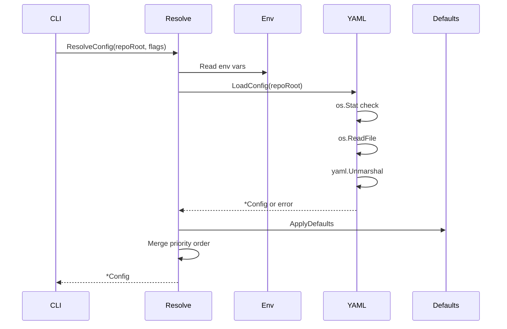

> **Module:** `internal/config` | **Source Files:** `config.go`, `io.go`, `resolve.go`

# internal/config Module

## Responsibility

The `internal/config` module provides configuration loading, resolution, and persistence for the Code-Reducer tool. It supports multiple configuration sources merged in priority order: system defaults, YAML config file, environment variables, and CLI flags. The module manages LLM backend configuration (Ollama), document directory paths, language overrides, extraction step definitions, and system prompts used across synthesis phases.

## Data Flow

## Configuration Schema

The `Config` struct holds all configuration state with YAML tags for serialization. Fields include:

- **LLM Backend**: `model_id`, `ollama_base_url`, `ollama_num_ctx`
- **Paths**: `docs_dir`, `config_file_path` (derived)
- **Language**: `language` (optional, omitted when empty)
- **Prompts**: `system_prompt`, `module_synthesis_prompt`, `architecture_prompt`, `quickstart_prompt`, `file_fact_consolidation_prompt`
- **Extraction Steps**: `extraction_steps` ([]ExtractionStep)
- **Ignore List**: `ignore` ([]string)

## Constants and Defaults

The module defines the following constants for system defaults and environment variable keys:

| Constant | Value |
|---|---|
| `CodeReducerModelIDEnvKey` | `"CODE_REDUCER_MODEL_ID"` |
| `CodeReducerLanguageEnvKey` | `"CODE_REDUCER_LANGUAGE"` |
| `OllamaBaseURLEnvKey` | `"OLLAMA_BASE_URL"` |
| `OllamaNumCtxEnvKey` | `"OLLAMA_NUM_CTX"` |
| `OllamaDefaultBaseURL` | `"http://localhost:11434"` |
| `OllamaDefaultModelID` | `"ornith:9b"` |
| `OllamaDefaultNumCtx` | `8192` |
| `DefaultDocsDir` | `"wiki"` |
| `ConfigFileName` | `".code-reducer.yaml"` |
| `configFilePerm` | `0600` |

## Extraction Steps

The `ExtractionStep` struct defines analysis phases with `Name` and `Prompt` fields. The default extraction sequence consists of four phases:

1. **API_SIGNATURES** — Extract public API surface (types, functions, methods)
2. **BUSINESS_LOGIC** — Define configuration schema and defaults
3. **STATE_AND_CONCURRENCY** — Analyze state and concurrency patterns
4. **ERRORS_AND_SIDE_EFFECTS** — Analyze external I/O and error propagation

Each phase specifies output constraints and falls back to `"None"` when no applicable items exist.

## File I/O Operations

The `internal/config/io.go` file provides three public functions:

- **`ConfigExists(cwd string) bool`** — Checks whether the configuration file exists at the resolved path using `os.Stat`.
- **`LoadConfig(cwd string) (*Config, error)`** — Reads the YAML file via `os.ReadFile`, unmarshals into `Config`, and returns nil config on read failure. Wraps parse errors with `"failed to parse yaml config: %w"`.
- **`SaveConfig(cwd string, cfg *Config) error`** — Marshals `Config` to YAML, applies formatting rules (blank lines before specific keys), and writes atomically via `tools.WriteFileAtomic` with `configFilePerm`.

## Configuration Resolution

The `internal/config/resolve.go` file provides `ResolveConfig(repoRoot, modelIDFlag, numCtxFlag, languageFlag string) (*Config, error)`. Resolution merges sources in priority order:

1. System defaults (empty/zero fields)
2. YAML config file (via `LoadConfig`)
3. Environment variables (via `os.Getenv`)
4. CLI flags

Key behaviors:

- **`ApplyDefaults`** — Sets `ModelID`, `OllamaBaseURL`, `OllamaNumCtx`, `DocsDir`, `Language`, all prompt fields, and `ExtractionSteps` from constants when empty or zero.
- **`ResolveConfig`** — Deduplicates the `Ignore` slice, validates `numCtx` as positive integer via `parsePositiveInt`, and returns empty `*Config{}` when config file is missing (not an error).
- **`resolveString`** — Trims whitespace and returns empty string for empty input.
- **`resolveNumCtx`** — Validates numeric input through env var and flag via `parsePositiveInt` with error propagation.
- **`filepath.ToSlash(filepath.Clean(cfg.DocsDir))`** — Normalizes document directory path.

## Error Handling

- YAML parse errors are wrapped with `fmt.Errorf("failed to parse yaml config: %w", err)`.
- YAML marshal errors are wrapped with `fmt.Errorf("failed to marshal yaml: %w", err)`.
- Config file absence returns empty config without error.
- Non-positive or non-integer numeric values return descriptive errors via `parsePositiveInt`.
- No synchronization mechanisms (locks, mutexes, channels, atomics) are present in the module.