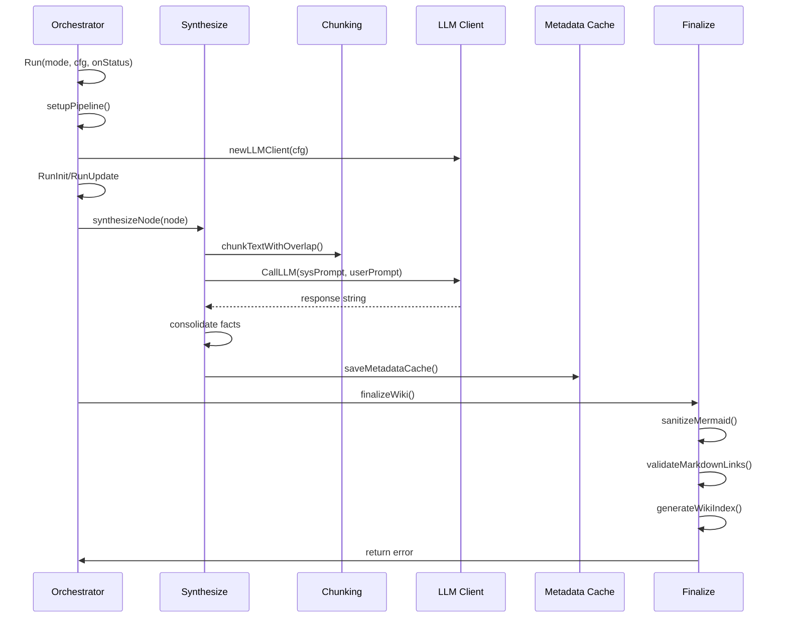

> **Module:** `internal/engine` | **Source Files:** `cache.go`, `chunking.go`, `client.go`, `finalize.go`, `orchestrator.go`, `synthesize.go`, `tree.go`

# internal/engine

## Module Responsibility

The `internal/engine` package orchestrates LLM-based synthesis of code documentation through a Map-Reduce pipeline. It discovers source files, builds a hierarchical directory tree, computes SHA-256 hashes for change detection, synthesizes documentation hierarchically via tree-merging, and maintains a versioned metadata cache to enable incremental regeneration.

## Data Flow

## Pipeline State

The orchestrator maintains a `pipelineState` struct containing the LLM client, repository root, configuration, metadata cache, affected directories, precalculated hashes, and status callback. These fields are set once per pipeline run and never modified afterward. A custom lock from `security.AcquireLock` is acquired at pipeline start and released via `defer lock.Unlock()`. No mutexes, channels, or atomics are used.

## Initialization and Mode Selection

`Run()` accepts a `RunMode` constant (`ModeInit` or `ModeUpdate`), a repository root path, a configuration pointer, and a status callback. `setupPipeline()` initializes the LLM client using `cfg.OllamaBaseURL` and `cfg.ModelID`, loads or creates the metadata cache, and returns the pipeline state along with the docs directory and cache pointer.

## File Discovery and Change Detection

`RunInit` and `RunUpdate` both discover code files, build a directory tree via `tree.go`, and compute SHA-256 hashes for each file. The cache stores per-file entries containing the SHA256 hash and extracted facts. Between runs, the engine compares current hashes against cached values to identify added, modified, or deleted files. The cache is persisted as indented JSON with a reset version on each save for forward compatibility.

## Hierarchical Synthesis

`synthesizeNode()` recursively traverses the directory tree. For each node, `synthesizeChildren()` processes child directories first, then `extractFileFacts()` processes individual files. File processing uses chunking with configurable overlap, and extraction results are cached by file hash to avoid redundant LLM invocations. Module summaries are persisted to the metadata cache and reused when downstream directories are unaffected, enabling incremental synthesis.

## LLM Communication

The `llmClient` struct holds the model ID, base URL, context window size, status callback, and HTTP client. `CallLLM()` sends a JSON array of messages to the Ollama `/api/chat` endpoint via HTTP POST with a 10-minute timeout. The request body is marshaled with the model ID, system and user messages, and options including `num_ctx` and a fixed temperature of 0.1. Response parsing errors are wrapped with "failed to parse response" context. Response truncation is detected when `done_reason` equals "length" and triggers a warning callback.

## Chunking and Batching

`chunking.go` orchestrates LLM-based synthesis by recursively reducing text items through batched context windows with loop prevention (stops when output ≥ 95% of input). Oversized text items are split into overlapping chunks before batching. Items matching "none", "n/a", or empty after stripping bullets/dots are excluded before processing. Outer markdown code fences are stripped from LLM responses while preserving intermediate fences.

## Finalization

`finalize.go` runs deterministic post-processing on generated markdown files. It sanitizes and heuristically validates Mermaid diagram blocks, degrading broken blocks to text fences with explanatory comments. A deterministic `index.md` navigation entrypoint is generated linking to architecture, quickstart, and all documented modules. Relative module/doc links are auto-repaired when unambiguous, and remaining broken internal links or heading anchors are stamped.

## Cache Structure

The `MetadataCache` struct contains `Files` (map of file paths to `FileCacheEntry`), `Modules` (map of module paths to summary strings), `StepsHash` (deterministic hash from configuration values), and `Version` (int). `FileCacheEntry` contains `SHA256` and `Facts` fields. No synchronization primitives are present in this file.

## Error Handling Patterns

Errors are propagated via `error` return values with `fmt.Errorf("...: %w", ...)` wrapping for context. Early `return err` is used on failure with `onStatus` warnings for non-critical issues. Nil callbacks default to no-op functions. File read errors return empty strings silently. Write errors are propagated as `fmt.Errorf`. HTTP errors fail fast without retries, limiting response bodies to 1024 bytes. Context cancellation is checked via `ctx.Err()` at the start of `reduceItems` and after each batch in the loop.