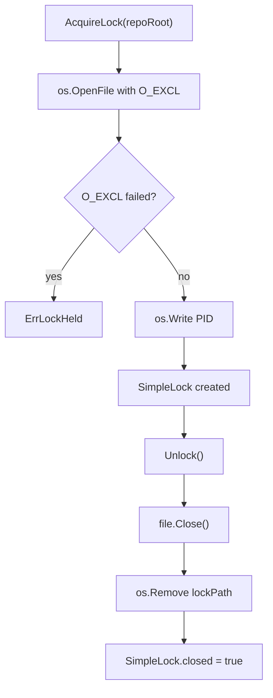

> **Module:** `internal/security` | **Source Files:** `security.go`

# Security Module

## Responsibility

Provides path-traversal-safe path resolution and file-based process locking for repository operations. Path resolution validates that resolved paths remain within the repository root after symlink evaluation. Locking uses atomic file creation with `O_EXCL` to prevent concurrent acquisition by multiple processes.

## Path Resolution

`SafeResolve(repoRoot, inputPath string) (string, error)` performs the following operations:

1. Calls `filepath.Abs` to obtain an absolute path
2. Calls `filepath.EvalSymlinks` on the repository root to resolve any symlinks in the ancestor chain
3. Iteratively calls `os.Lstat` to locate the closest physically existing ancestor path
4. Calls `filepath.Rel` to verify the resolved path stays within the repository root
5. Returns a wrapped `ErrPathTraversal` error if the path escapes the root

## Lock Acquisition and Release

`AcquireLock(repoRoot string) (*SimpleLock, error)` performs the following operations:

1. Calls `os.OpenFile` with `O_EXCL` flag for atomic lock file creation
2. On failure, returns a wrapped `ErrLockHeld` error
3. On success, calls `os.Write` to store the process PID in the lock file
4. Returns a `SimpleLock` value

`(*SimpleLock).Unlock() error` performs the following operations:

1. Calls `file.Close()` on the lock file descriptor
2. Calls `os.Remove` with `os.IsNotExist` check for idempotent cleanup
3. Sets `SimpleLock.closed` to `true`

## Internal State

`SimpleLock` contains the following mutable state:

- `mu` (`sync.Mutex`) — protects `Unlock`
- `closed` (`bool`) — set to `true` after `Unlock`
- `file` (`*os.File`) — closed during `Unlock`
- `lockPath` (`string`) — set during `AcquireLock`

`SafeResolve` and `AcquireLock` are stateless functions.

## Lock Lifecycle

## Error Types

- `ErrPathTraversal` — returned when resolved path escapes repository root
- `ErrLockHeld` — returned when lock file already exists (held by another process)

Both errors use `fmt.Errorf` with `%w` for chain preservation. Stale lock detection uses `os.IsExist` checks.