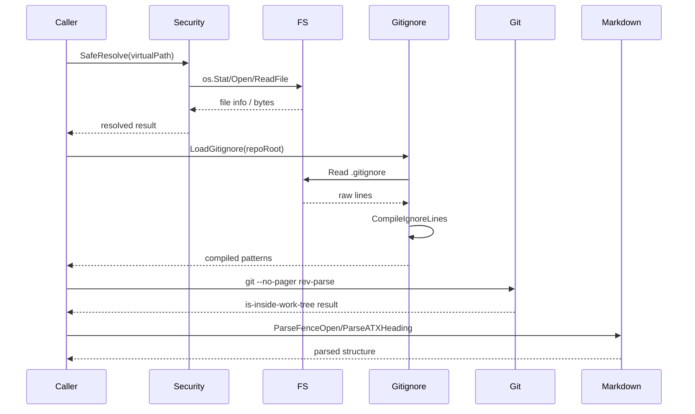

> **Module:** `internal/tools` | **Source Files:** `file_tools.go`, `git_tools.go`, `markdown.go`

# internal/tools

## Module Responsibility

The `internal/tools` module provides three capability domains: safe filesystem operations with path-traversal protection, git repository verification, and Markdown parsing for code-reducer documentation generation. All filesystem operations route through a security layer (`security.SafeResolve`) before touching the OS, ensuring virtual paths cannot escape the intended repository root.

## File Operations

### Safe File I/O

The `FileExistsSafely`, `RemoveFileSafely`, `ReadFileSafely`, and `WriteFileSafely` functions resolve virtual paths through `security.SafeResolve` to prevent path traversal attacks. `WriteFileAtomic` implements the temp-file-plus-rename pattern using `os.CreateTemp`, `os.Rename`, and `os.Chmod` with deferred cleanup. `WriteFileSafely` applies a TOCTOU-safe write pattern. `RemoveFileSafely` treats `os.IsNotExist` as a non-error condition.

### Gitignore Management

`LoadGitignore` reads active ignore patterns from the repository. `EnsureGitignoreHasLockfile` guarantees lockfile entries are present in `.gitignore`. `ShouldIgnoreFile` evaluates paths against compiled ignore patterns from `github.com/sabhiram/go-gitignore`.

### Code File Discovery

`DiscoverCodeFiles` recursively walks the codebase directory tree using `filepath.WalkDir`. It skips directories matching ignore patterns, binary/non-regular files, and files matching skip rules (specific filenames like `go.sum`, `LICENSE`, `Dockerfile`; extensions like `.lock`, `.md`, `.png`; test suffixes like `_test.go`, `.spec.ts`). Binary detection reads the first 512 bytes and checks for null bytes.

## Git Operations

### Repository Verification

`VerifyGitRepo` executes `git --no-pager rev-parse --is-inside-work-tree` with the working directory set to `repoRoot`. Subprocess stderr is captured into a `bytes.Buffer` and included in error messages. Returns `nil` on success; wraps the original error with context and captured stderr on failure.

## Markdown Parsing

### Code Block and Heading Parsing

`ParseFenceOpen` validates fenced code block openers (```` or ~~~~) by checking fence character, length, and info string. `IsFenceClose` matches the closing declaration against the opening declaration. `ParseATXHeading` extracts heading levels 1–6 and titles with whitespace handling. `SlugifyHeading` replaces spaces with hyphens and lowercases for GitHub-style anchors. `NextHeadingAnchor` resolves duplicate slugs by appending numeric suffixes (e.g., `section-1`, `section-2`). `TruncateRunes` limits rune count.

### Concurrency Note

`NextHeadingAnchor` mutates the `seenCounts` map parameter without synchronization. Callers must manage concurrent access externally.

## Internal Data Flow

